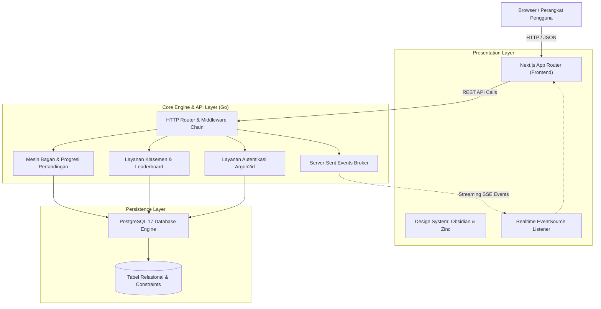

# Gridify: Esports Tournament Operations Platform

> [!NOTE]
> Proyek ini berstatus Proprietary dan Rahasia (Confidential). Seluruh kode sumber, dokumentasi, arsitektur, dan materi terkait merupakan rahasia dagang serta hak milik eksklusif dari Shironeko's Project. Akses, pendistribusian, modifikasi, maupun publikasi tanpa izin tertulis dilarang keras.

---

## Gambaran Umum

Gridify adalah platform operasional turnamen esports presisi tinggi yang dirancang untuk mengelola kompetisi profesional secara terstruktur, terpusat, dan otomatis. Sistem ini menggantikan proses pengelolaan turnamen manual dengan mengintegrasikan mesin pembuatan bagan pertandingan matematis, penegakan aturan kompetisi berlapis, penghitungan klasemen otomatis, serta distribusi status pertandingan langsung ke penonton.

Arsitektur Gridify memisahkan secara tegas antara antarmuka pengguna berbasis Next.js dan mesin logika bisnis inti berbasis Go yang terhubung langsung ke basis data relasional PostgreSQL. Seluruh perhitungan progresi turnamen dilakukan di sisi server untuk menjamin integritas data kompetisi.

---

## Format Kompetisi yang Didukung

Sistem mendukung 5 format turnamen kompetitif dengan penanganan aturan pertandingan yang komprehensif:

| Format Turnamen | Deskripsi Teknis | Mekanisme Eliminasi / Poin |
| :--- | :--- | :--- |
| Single Elimination | Sistem gugur tunggal berpasangan pangkat dua dengan seeding otomatis | Peserta gugur setelah 1 kali kalah. Mendukung perebutan tempat ketiga (Bronze Match). Auto-advance untuk slot BYE. |
| Double Elimination | Sistem gugur ganda dengan Upper Bracket dan Lower Bracket terpisah | Peserta gugur setelah 2 kali kalah. Pemetaan otomatis peserta yang kalah dari Upper Bracket ke ronde Lower Bracket yang sesuai. |
| Round Robin | Sistem liga penuh di mana setiap peserta bertanding melawan seluruh peserta lain | Perhitungan poin menang, seri, dan kalah terkonfigurasi. Mendukung jadwal 1 putaran (Single Leg) maupun 2 putaran (Home and Away). |
| Hybrid UCL | Kombinasi fase grup Round Robin yang dilanjutkan ke babak gugur Playoff | Peserta dibagi ke dalam beberapa grup. Peringkat teratas tiap grup lolos otomatis ke bagan gugur dengan mekanisme undian silang (Cross-Seeding). |
| Battle Royale | Kompetisi serentak multi-tim dalam beberapa putaran pertandingan | Akumulasi poin dinamis berdasarkan peringkat bertahan hidup (Placement Points) dan jumlah eliminasi lawan (Kill Points). |

---

## Arsitektur Sistem

Gridify dibangun menggunakan pendekatan arsitektur berlapis (Clean Architecture) dengan pemisahan tanggung jawab yang modular:

---

## Modul dan Kapabilitas Utama

### 1. Manajemen Sesi dan Keamanan Otorisasi
- Autentikasi sesi berbasis HttpOnly Secure Cookie yang dikelola secara langsung oleh backend Go.
- Pengacakan kata sandi menggunakan algoritma Argon2id berstandar industri kriptografi modern.
- Proteksi kepemilikan turnamen (Ownership Guard) yang mencegah modifikasi atau manipulasi data oleh pihak yang tidak memiliki hak akses.
- Penguncian mutasi peserta secara otomatis saat turnamen telah memasuki status aktif (Ongoing).

### 2. Mesin Penjadwalan dan Progresi Pertandingan
- Pembuatan bagan pertandingan berbasis transaksi database tunggal untuk menjamin konsistensi data.
- Algoritma seeding standar internasional untuk penempatan peserta dan distribusi slot BYE yang adil.
- Mesin validasi aturan Best-of (BO1, BO3, BO5) pada setiap pertandingan.
- Perlindungan integritas bagan dari modifikasi skor yang berpotensi merusak pertandingan hilir yang telah selesai dimainkan.

### 3. Layanan Klasemen dan Leaderboard Terpadu
- Perhitungan matriks klasemen liga secara otomatis: jumlah main, menang, seri, kalah, gol memasukkan, gol kemasukan, selisih gol, dan total poin.
- Penghitungan peringkat Battle Royale multi-ronde dengan sistem prioritas: Total Poin, Kemenangan Ronde (WWCD), Poin Posisi, dan Total Eliminasi.
- Penyediaan data podium juara terpadu (Juara 1, Juara 2, Juara 3) untuk seluruh jenis format kompetisi.

### 4. Distribusi Data Realtime
- Penyampaian pembaruan skor dan bagan pertandingan menggunakan protokol Server-Sent Events (SSE).
- Pembaruan layar penonton secara langsung tanpa memerlukan reload halaman manual.
- Mekanisme deteksi heartbeat berkala untuk menjaga stabilitas koneksi jaringan.

### 5. Antarmuka Operasional
- Desain antarmuka fokus operasional dengan tema Obsidian dan Zinc gelap untuk keterbacaan data maksimal.
- Visualisasi bagan pertandingan berbasis garis ortogonal SVG dinamis.
- Tipografi angka tabular berbasis font monospace untuk penyajian skor dan statistik yang presisi.

---

## Spesifikasi Data dan Kontrak API

Seluruh komunikasi antara lapisan presentasi dan lapisan mesin logika diatur melalui kontrak OpenAPI 3.0 yang terdokumentasi pada direktori kontrak sistem. Format pertukaran data menggunakan struktur respons terenkapsulasi standar untuk memastikan konsistensi penanganan data dan kode kesalahan.

---

## Hak Cipta dan Kepemilikan

Hak cipta dan seluruh hak kepemilikan intelektual atas perangkat lunak ini dipegang secara penuh oleh Shironeko's Project. Penggunaan, penyalinan, modifikasi, penggabungan, publikasi, maupun pendistribusian materi ini tunduk pada ketentuan hukum yang tercantum dalam dokumen LICENSE.
