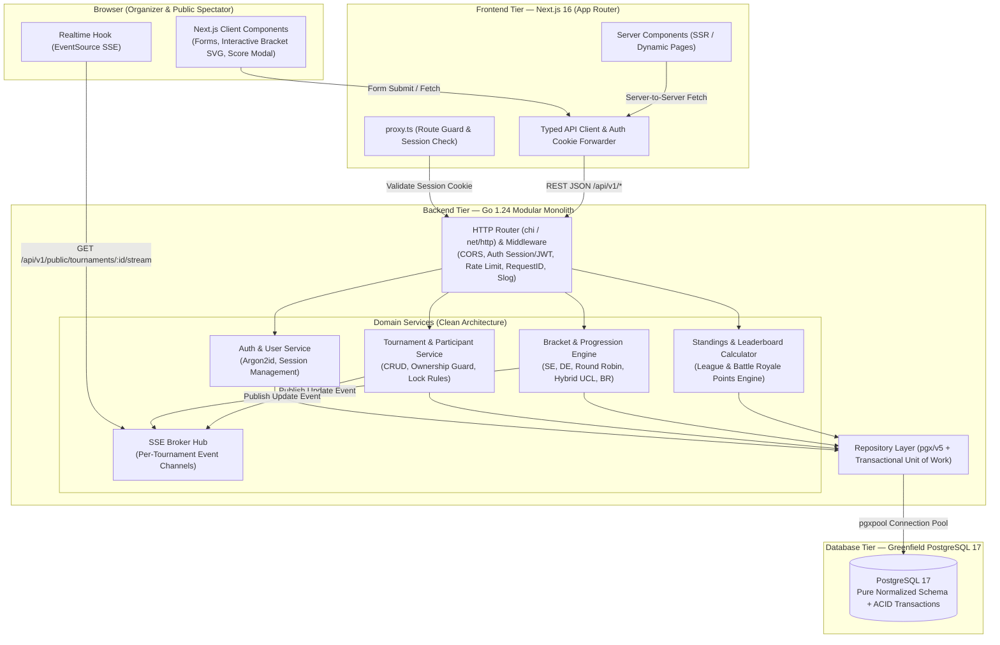

# IMPLEMENTATION PLAN — GRIDIFY MAJOR REVAMP (NEXT.JS + GO + POSTGRESQL)

**Dokumen Panduan Eksekusi Arsitektur, Keamanan, Database, dan Redesign UI/UX**
- **Proyek**: Gridify (Esports & Sports Tournament Bracket Generator & Management Platform)
- **Status Dokumen**: Ready for Execution (Phase 0–4 Audit & Planning Completed)
- **Target Stack**: Next.js 16 (App Router, TypeScript Strict) + Go 1.24 (Modular Monolith) + PostgreSQL 17 (Greenfield / Clean-Slate Database)
- **Aturan Fase Saat Ini**: Dokumen perencanaan eksekusi (Zero Code Mutation pada tahap audit)

## 1. Executive Summary

### 1.1 Kondisi Proyek Saat Ini
Gridify saat ini merupakan aplikasi monolitik berbasis **Next.js 16.0.10 (App Router)** dan **React 19.2.1** yang terikat langsung (*tightly coupled*) ke **Supabase (PostgREST, Supabase Auth, dan Supabase Realtime)** tanpa layanan backend mandiri. Seluruh operasi data dan aturan bisnis dijalankan melalui kombinasi *Next.js Server Components*, *Server Actions* (`features/*/actions/*.ts`), dan pemanggilan langsung *Supabase Browser SDK* dari komponen klien (`app/login/page.tsx`, `app/register/page.tsx`, `hooks/use-tournament-realtime.ts`).

Repositori tidak memiliki satupun file migrasi SQL, definisi *constraints*, maupun kebijakan *Row-Level Security (RLS)* yang terdokumentasi di dalam kontrol versi—hanya mengandalkan definisi tipe manual pada `types/database.ts`. Selain itu, konfigurasi `next.config.ts` secara eksplisit mengaktifkan `typescript: { ignoreBuildErrors: true }` yang menyembunyikan berbagai ketidakcocokan tipe data dan bug kompilasi di seluruh codebase.

### 1.2 Masalah Utama yang Ditemukan
Berdasarkan hasil audit kode sumber secara menyeluruh terhadap seluruh 52 file proyek, ditemukan lima kelompok masalah struktural yang mengharuskan perombakan menyeluruh (*major revamp*):

1. **Celah Keamanan & Otorisasi Kritis (Broken Access Control / IDOR)**:
   Sebagian besar *Server Actions* yang memodifikasi data inti (`generateBracketAction`, `updateMatchDetails`, `updateBRMatchScoreAction`, `updateMatchParticipantAction`, `advanceToKnockoutAction`, `addParticipant`, `updateParticipant`) **tidak memeriksa sesi pengguna (`getUser()`) maupun kepemilikan turnamen (`owner_id`)**. Siapa pun yang mengetahui UUID turnamen atau pertandingan dapat mereset bracket, mengubah skor pertandingan, atau mengganti nama tim secara sepihak. Halaman login (`app/login/page.tsx`) juga melakukan *query* tabel `profiles` langsung dari browser sebelum autentikasi (celah *user/email enumeration*), dan `app/auth/callback/route.ts` rentan terhadap *Open Redirect*.
2. **Bug Algoritma Turnamen & Kebocoran Business Logic ke Frontend**:
   - **Double Elimination Rusak pada BYE & Drop-Down**: Generator `features/bracket/generators/double-elimination.ts` menandai match BYE di Round 1 sebagai `COMPLETED`, tetapi tidak memajukan pemenang ke Round 2 dan membiarkan match Lower Bracket Round 1 menggantung tanpa peserta. Selain itu, rumus *drop-to-lower-bracket* di `features/bracket/services/progression-service.ts` (`targetLBRound = -((wbRound * 2) - 1)` dan `targetMatchNum = Math.ceil(match_number / 2)`) salah memetakan *loser* Upper Bracket Round 2+ pada turnamen ≥ 8 tim.
   - **Hybrid UCL Gagal di Babak Knockout**: `advanceToKnockoutAction` di `features/bracket/actions/stage-actions.ts` hanya membuat match Round 1 untuk format `SINGLE_ELIMINATION` tanpa membuat babak Semifinal/Final dan tanpa menyambungkan `next_match_id`.
   - **Duplikasi Perhitungan Klasemen di UI**: Perhitungan poin Liga/Round Robin ditulis ulang di tiga tempat berbeda (`stage-actions.ts`, `standings-table.tsx`, dan `standings/page.tsx`), sedangkan perhitungan poin Battle Royale ditulis ulang di `br-leaderboard.tsx` dan `br-score-modal.tsx` dengan konstanta poin statis yang mengabaikan `tournament.settings`.
   - **Halaman Klasemen Rusak Total**: `app/dashboard/tournaments/[id]/standings/page.tsx` melakukan *query* ke kolom fiktif (`player1_id`, `player2_id`, `player1_score`, `player2_score`) yang tidak sesuai dengan skema tabel `matches` (`participant_a_id`, `participant_b_id`, `scores`).
3. **Masalah Integritas Database & Ketiadaan Transaksi Atomik**:
   Penghapusan turnamen (`deleteTournament`), pembuatan turnamen beserta stage (`createTournamentAction`), dan pembuatan bracket (`generateBracketAction`) mengeksekusi banyak *query* HTTP secara berurutan tanpa transaksi database (`BEGIN ... COMMIT`). Jika langkah tengah gagal, data menjadi korup atau bracket lama hilang permanen. Kolom JSONB `matches.scores` juga menyimpan struktur polimorfik (skor 1v1 sekaligus array hasil Battle Royale dan rotasi grup) tanpa *foreign key* atau validasi skema.
4. **Kualitas Kode & Konfigurasi Dependency**:
   Penggunaan versi `"latest"` pada `@supabase/ssr`, `@supabase/supabase-js`, `lucide-react`, dan `typescript`; ketidakcocokan `@types/react` (`^18.3.27`) dengan React `19.2.1`; serta dependency `@tanstack/react-query` yang diinisialisasi di `AppProviders` namun tidak pernah dipakai di satu pun komponen.
5. **Desain Visual "AI Slop" & Masalah Usability**:
   Antarmuka dipenuhi dekorasi khas *template* AI generatif: *glowing blurred blobs* raksasa (`blur-[100px]` hingga `blur-[128px]`) di hampir setiap halaman, gradasi teks dan tombol neon (`indigo-500` ke `purple-600` ke `pink-600`), penggunaan *glassmorphism* (`bg-white/5 backdrop-blur-xl`) berlapis di atas latar gelap yang menurunkan kontras, pencampuran warna heksadesimal statis (`#1a1b26`, `#0f1016`) dengan palet `slate-950`, bug konfigurasi font di `app/globals.css` (menimpa `Inter` dengan `Arial, Helvetica, sans-serif`), penggunaan `window.confirm()` bawaan browser, serta garis konektor bracket berbasis CSS `div` absolut yang pecah saat jumlah peserta besar.

### 1.3 Visi Arsitektur dan Produk Setelah Revamp
Revamp ini mentransformasikan Gridify menjadi platform manajemen turnamen kelas produksi dengan pemisahan tanggung jawab yang tegas:
- **Backend Go (Golang) sebagai Single Source of Truth**: Modular monolith berbahasa Go yang menangani autentikasi sesi berbasis HttpOnly cookie (Argon2id), otorisasi kepemilikan turnamen, seluruh generator bracket (Single/Double Elimination, Round Robin, Hybrid UCL, Battle Royale), mesin progresi pertandingan yang deterministik, kalkulasi klasemen, dan kanal *Server-Sent Events (SSE)* untuk pembaruan *realtime*.
- **Database PostgreSQL 17 Baru yang Murni (Greenfield Relational Schema)**: Membangun database PostgreSQL baru dari nol tanpa membawa beban kompatibilitas atau backup dari Supabase lama. Skema dirancang murni berdasarkan kebutuhan domain dan temuan audit: menggunakan migrasi terversi (`golang-migrate`), *foreign key constraints* (`ON DELETE CASCADE`), *check constraints* ketat di level tabel, pemisahan tabel hasil Battle Royale dari skor match head-to-head, dan eksekusi mutasi di dalam transaksi ACID.
- **Next.js sebagai Presentation Layer Modern & Bebas "AI Slop"**: Antarmuka pengguna yang mengadopsi estetika *Esports Operations System* yang bersih, tajam, kontras tinggi, tipografi presisi (`Geist Sans` & `Geist Mono`), visualisasi bracket berbasis SVG dinamis yang presisi di semua ukuran turnamen, serta pengalaman pengguna yang konsisten dalam Bahasa Indonesia.

## 2. Current State Audit

### 2.1 Architecture & Tech Stack Audit

#### A. Pemetaan Tech Stack & Dependency Saat Ini
Berdasarkan `package.json`, `tsconfig.json`, `next.config.ts`, dan `postcss.config.mjs`:
- **Framework**: Next.js `16.0.10` (App Router, menggunakan konvensi `proxy.ts` baru di Next.js 16 sebagai pengganti `middleware.ts`).
- **UI Runtime**: React `19.2.1` dan `react-dom` `19.2.1`, namun `devDependencies` masih menggunakan `@types/react: "^18.3.27"` dan `@types/react-dom: "^18.3.7"`.
- **Styling**: Tailwind CSS `^4.1.17` via `@tailwindcss/postcss`, tetapi `devDependencies` masih menyertakan `autoprefixer: "latest"` yang tidak lagi diperlukan di Tailwind v4.
- **Data & Auth SDK**: `@supabase/supabase-js: "latest"` dan `@supabase/ssr: "latest"`. Penggunaan tag `"latest"` sangat berbahaya karena pembaruan *breaking changes* dari registry npm dapat memutus build sewaktu-waktu.
- **State & UI Libraries**:
  - `@tanstack/react-query` (`^5.90.11`) dan `@tanstack/react-query-devtools` (`^5.91.1`): Terpasang di `components/providers/app-providers.tsx`, namun **tidak ada satu pun pemanggilan `useQuery` atau `useMutation`** di seluruh aplikasi. Ini adalah *dead weight* di bundle klien.
  - `@headlessui/react` (`^2.2.9`): Hanya dipakai di `features/bracket/components/score-modal.tsx` (`Dialog`, `Transition`), sementara modal lain seperti `br-score-modal.tsx` dan popover `share-button.tsx` dibuat manual dengan `fixed inset-0` tanpa manajemen fokus (*focus trap*) atau aksesibilitas `Escape` key.
  - `framer-motion` (`^12.23.26`): Hanya dipakai untuk animasi masuk sederhana di komponen *landing page* (`navbar.tsx`, `hero.tsx`, `features.tsx`, `how-it-works.tsx`), sementara halaman aplikasi menggunakan class animasi CSS (`animate-in fade-in`).
  - `zod` (`^4.1.13`): Hanya digunakan di satu file (`features/tournaments/actions/tournament-actions.ts`), sedangkan form dan *Server Actions* lainnya melakukan validasi string manual yang minim.

#### B. Struktur Direktori & Pola Komunikasi Saat Ini
Proyek saat ini menggabungkan routing halaman (`app/`) dan modul fitur (`features/auth`, `features/tournaments`, `features/participants`, `features/bracket`). Namun, batas arsitektur antar-modul mengalami kebocoran parah:
- **Komponen UI Memanggil Supabase Secara Langsung**: `app/login/page.tsx`, `app/register/page.tsx`, `app/forgot-password/page.tsx`, `app/update-password/page.tsx`, `features/auth/components/security-form.tsx`, dan `app/dashboard/layout.tsx` menginisialisasi `createBrowserClient` dan mengeksekusi operasi autentikasi maupun query tabel secara langsung dari browser.
- **Server Components Menjalankan Query Database Tanpa Service Layer**: Setiap file `page.tsx` dan `layout.tsx` di bawah `app/dashboard/` dan `app/(public)/t/[id]/` menulis query `.from(...).select(...)` mentah sendiri-sendiri dengan struktur *join* yang berbeda-beda.
- **Penonaktifan Type Checking pada Build**: Di `next.config.ts`, opsi `typescript: { ignoreBuildErrors: true }` diaktifkan untuk memaksa build berhasil meskipun terdapat *type errors* nyata di beberapa komponen dan halaman.

#### C. Evaluasi Komponen: Pertahankan, Refactor, atau Tulis Ulang
| Area / Modul Saat Ini | Lokasi File | Keputusan | Alasan Teknis |
| :--- | :--- | :--- | :--- |
| **Algoritma Matematika Seeding & Rotasi** | `features/bracket/utils/bracket-math.ts` | **Port ke Go & Perbaiki** | Logika `getStandardSeedingOrder`, `distributeParticipants`, dan `distributeTeamsToGroups` memiliki dasar yang baik, namun wajib dipindahkan ke domain service Go dan dilengkapi unit test deterministik. |
| **Generator Bracket & Progresi** | `features/bracket/generators/*.ts`, `features/bracket/services/progression-service.ts` | **Tulis Ulang di Go** | Mengandung bug fatal pada Double Elimination, BYE handling, dan Hybrid UCL, serta melakukan operasi database N+1 tanpa transaksi. |
| **Server Actions (`features/*/actions/*.ts`)** | `features/auth/actions/*`, `features/bracket/actions/*`, `features/participants/actions/*`, `features/tournaments/actions/*` | **Ganti dengan Go REST API + Next.js API Client** | Seluruh *business logic* dan mutasi database harus dipusatkan di backend Go. Next.js hanya boleh menggunakan API client terstandarisasi atau server actions tipis sebagai *proxy* ke Go. |
| **Realtime Listener (`hooks/use-tournament-realtime.ts`)** | `hooks/use-tournament-realtime.ts`, `components/providers/tournament/realtime-listener.tsx` | **Refactor ke SSE Client** | Saat ini bergantung pada `supabase.channel('postgres_changes')`. Harus diganti dengan *Server-Sent Events (SSE)* (`EventSource`) yang terhubung ke endpoint streaming Go. |
| **Komponen UI & Halaman (`app/**`, `components/**`, `features/*/components/**`)** | Seluruh file `.tsx` | **Refactor & Redesign di Next.js** | Struktur halaman App Router dapat dipertahankan, tetapi implementasi visual, design tokens, komponen bracket, dan kalkulasi klasemen di klien harus dirombak. |

### 2.2 Backend, Security & Business Logic Audit

#### A. Audit Authentication, Authorization & Security
1. **Tidak Ada Pemeriksaan Otorisasi pada Mutasi Bracket, Match, dan Peserta (CRITICAL)**:
   - `features/bracket/actions/bracket-actions.ts` (`generateBracketAction`): Menerima `tournamentId: string`, langsung menghapus seluruh match pada stage (`await supabase.from("matches").delete().eq("stage_id", stage.id)`) dan membuat ulang jadwal tanpa memverifikasi `supabase.auth.getUser()` maupun `tournament.owner_id`.
   - `features/bracket/actions/match-actions.ts` (`updateMatchDetails`, `updateBRMatchScoreAction`, `updateMatchParticipantAction`): Tidak memeriksa identitas pemanggil sama sekali. Lebih parah lagi, pada baris 19–28 di `updateMatchDetails`:
     ```ts
     for (const p of participants) {
       if (p.id && p.name) {
         await supabase.from("participants").update({ name: p.name }).eq("id", p.id);
       }
     }
     ```
     Loop tersebut memperbarui nama peserta berdasarkan `p.id` saja tanpa memeriksa apakah peserta tersebut milik `tournamentId` yang sedang diedit maupun apakah pemanggil adalah pemilik turnamen.
   - `features/bracket/actions/stage-actions.ts` (`advanceToKnockoutAction`): Tidak memiliki pengecekan autentikasi dan kepemilikan turnamen.
   - `features/participants/actions/participant-actions.ts`: Fungsi `addParticipant` dan `updateParticipant` tidak memanggil `supabase.auth.getUser()`. Fungsi `deleteParticipant` memang memanggil `getUser()`, tetapi **tidak memeriksa apakah turnamen tempat peserta tersebut berada adalah milik `user.id`**.
2. **User & Email Enumeration pada Login dengan Username (HIGH)**:
   Pada `app/login/page.tsx` (baris 25–36), ketika pengguna memasukkan *username* (bukan email), browser mengeksekusi:
   ```ts
   const { data: profile } = await supabase
     .from('profiles')
     .select('email')
     .eq('username', emailToLogin)
     .single()
   ```
   Ini berarti tabel `profiles` harus dapat dibaca secara publik oleh *anon key* agar login via username berjalan, yang sekaligus mengekspos alamat email seluruh pengguna kepada publik dan memungkinkan enumerasi daftar akun.
3. **Open Redirect pada Auth Callback (MEDIUM)**:
   Pada `app/auth/callback/route.ts` (baris 7 & 16–22), parameter query `next` diambil mentah (`const next = searchParams.get('next') ?? '/dashboard'`) lalu digabungkan ke URL redirect. Jika penyerang mengirimkan `?code=...&next=//attacker.com`, pengguna dapat diarahkan ke domain eksternal setelah pertukaran sesi berhasil.
4. **Kebijakan Password Lemah & Inkonsistensi Sinkronisasi Profil (MEDIUM)**:
   Password hanya divalidasi minimal 6 karakter (`register/page.tsx`, `update-password/page.tsx`, `profile-actions.ts`). Selain itu, `updateBasicInfoAction` di `features/auth/actions/profile-actions.ts` hanya menyimpan `first_name`, `last_name`, dan `phone` ke dalam `auth.users.user_metadata`, tanpa memperbarui tabel `profiles`. Fungsi `updateEmailAction` dan `updatePasswordAction` di `profile-actions.ts` merupakan *dead code* yang tidak pernah dipanggil di UI.

#### B. Audit Domain Logic & Algoritma Turnamen
1. **Bug Fatal Double Elimination — Penanganan BYE di Round 1 (`features/bracket/generators/double-elimination.ts` baris 166–187)**:
   Saat jumlah peserta bukan pangkat dua (misal 6 tim di bracket 8 slot), generator mengatur match Round 1 yang tidak memiliki lawan (`isBye = pA && !pB`) menjadi `status: "COMPLETED"` dan `winner_id: pA.id`. Namun:
   - Generator **tidak memindahkan `pA.id` ke slot match Round 2 (`next_match_id`)** (berbeda dengan `single-elimination.ts` baris 115–123 yang melakukan *auto-advance*). Akibatnya, `pA` berhenti di Round 1 dan tidak muncul di Round 2 sampai admin mengedit skor Round 1 secara manual.
   - Generator menggunakan `participants[index * 2]` dan `participants[index * 2 + 1]` secara berurutan tanpa menggunakan `getStandardSeedingOrder`, sehingga semua BYE menumpuk di match terakhir Round 1. Ketika dua match terakhir keduanya BYE, match Lower Bracket Round 1 yang menunggu *loser* dari kedua match tersebut menjadi kosong selamanya dan tidak pernah ditandai selesai, sehingga `checkAndCompleteStage` tidak akan pernah menandai turnamen `COMPLETED`.
2. **Bug Fatal Double Elimination — Pemetaan Drop-to-Lower-Bracket (`features/bracket/services/progression-service.ts` baris 20–52)**:
   - Rumus `let targetLBRound = -((wbRound * 2) - 1)` salah untuk struktur ronde Lower Bracket yang dibuat oleh `double-elimination.ts`. Di `double-elimination.ts`, untuk 8 tim (`wbRounds = 3`, `lbTotalRounds = 4`):
     - LB Round `-1` (2 match): mempertemukan 4 *loser* dari WB Round 1.
     - LB Round `-2` (2 match): mempertemukan 2 pemenang LB Round `-1` melawan 2 *loser* dari WB Round 2 (UB Semifinal).
     - Namun, di `dropToLowerBracket`, ketika match WB Round 2 selesai, `nextMatchData.round_number` adalah `3` (UB Final, bukan `999`), sehingga koreksi `if (nextMatchData.round_number === 999) targetLBRound += 1` tidak dijalankan. Akibatnya, *loser* WB Round 2 dikirim ke `targetLBRound = -((2 * 2) - 1) = -3` (LB Semifinal), melompati LB Round `-2`!
   - Selain itu, pada `wbRound > 1`, `targetMatchNum = Math.ceil(currentMatch.match_number / 2)` menyebabkan *loser* dari WB R2 Match 1 (`ceil(1/2) = 1`) dan WB R2 Match 2 (`ceil(2/2) = 1`) keduanya dimasukkan ke Match #1 di Lower Bracket, sedangkan Match #2 di Lower Bracket tidak pernah menerima *loser* dari Upper Bracket.
3. **Bug Fatal Hybrid UCL — Babak Knockout Single Elimination Tidak Lengkap (`features/bracket/actions/stage-actions.ts` baris 129–153)**:
   Saat turnamen berformat `HYBRID_UCL` dengan game bergenre `SPORTS` (yang membuat Stage 2 bertipe `SINGLE_ELIMINATION`), fungsi `advanceToKnockoutAction` melakukan `insert` manual hanya untuk `round_number: 1` tanpa membuat match babak berikutnya (Semifinal/Final) dan tanpa mengisi `next_match_id`. Berbeda dengan cabang `DOUBLE_ELIMINATION` (baris 192) yang memanggil `generateDoubleElimination`, cabang `SINGLE_ELIMINATION` tidak memanggil `generateSingleElimination`.
4. **Koreksi Skor Tidak Membatalkan Progresi Hilir (`features/bracket/actions/match-actions.ts`)**:
   Jika admin salah memasukkan skor pada Match #1 (sehingga Tim A maju ke Round 2 dan Tim B turun ke Lower Bracket), lalu admin mengoreksi skor Match #1 sehingga Tim B yang menang, `updateMatchDetails` hanya menimpa slot di match berikutnya tanpa memeriksa apakah match selanjutnya sudah dimainkan dan tanpa menghapus Tim A dari Lower Bracket jika terjadi perubahan pemenang.
5. **Ketidaksesuaian Enum Status Match (`features/bracket/actions/match-actions.ts` baris 55)**:
   Jika skor seri (`scores.a === scores.b`), `updateMatchDetails` menyimpan `status = "IN_PROGRESS"`, padahal tipe `Match["status"]` di `types/database.ts` dan seluruh filter UI menggunakan `"SCHEDULED" | "ONGOING" | "COMPLETED"`.
6. **Inkonsistensi Perhitungan Klasemen Liga (`StandingsTable` vs `advanceToKnockoutAction` vs `StandingsPage`)**:
   - `features/bracket/components/standings-table.tsx` (baris 30) menghitung match ke dalam klasemen jika `m.status === 'COMPLETED' || (m.scores && (m.scores.a > 0 || m.scores.b > 0))` serta hanya mengurutkan berdasarkan `points` lalu `gd` (tanpa tie-breaker `gf`).
   - `features/bracket/actions/stage-actions.ts` (baris 37 & 112) hanya menghitung match dengan `status === "COMPLETED"` dan mengurutkan berdasarkan `points`, `gd`, lalu `gf`. Akibatnya, urutan tim yang tampil di tabel UI dapat berbeda dengan tim yang diloloskan ke babak *knockout* oleh server!
   - Kedua file tersebut mengabaikan konfigurasi `tournament.settings.pointsPerWin` dan selalu mematok 3 poin untuk menang.

### 2.3 Database & Data Integrity Audit

Berdasarkan penelusuran `types/database.ts` dan seluruh query Supabase di codebase, skema database lama terdiri dari 6 entitas (`games`, `tournaments`, `stages`, `participants`, `matches`, serta `profiles` yang direferensikan di `app/login/page.tsx` namun tidak ada di `types/database.ts`).

Masalah utama pada desain database saat ini yang wajib diperbaiki pada database PostgreSQL baru:
1. **Ketiadaan Skema & Migrasi Terkontrol**: Tidak ada file `.sql` di dalam repositori. Pengembang atau AI coding agent tidak dapat mereproduksi database secara lokal tanpa menebak struktur tabel dari kode TypeScript.
2. **Penyalahgunaan Kolom Polimorfik JSONB `matches.scores`**:
   Kolom `scores` di tabel `matches` dipakai untuk menyimpan:
   - Skor pertandingan reguler: `{ "a": 2, "b": 1, "note": "BYE" }`
   - Metadata grup Battle Royale: `{ "groups": ["A", "B"] }`
   - Array hasil akhir seluruh tim Battle Royale: `{ "results": [{ "teamId": "...", "rank": 1, "kills": 12, "total": 22 }] }`
   Desain ini melanggar normalisasi dasar: `teamId` di dalam JSONB tidak memiliki *foreign key constraint* ke `participants(id)`, tidak dapat diindeks untuk agregasi cepat di level SQL, dan memaksa aplikasi mengunduh seluruh dokumen JSONB untuk menghitung klasemen di memori JavaScript.
3. **Ketiadaan Relasi Eksplisit untuk Jalur Kalah (`loser_next_match_id`) dan Posisi Slot**:
   Tabel `matches` hanya memiliki `next_match_id` tanpa `next_match_slot` (`A` atau `B`) dan tanpa `loser_next_match_id` / `loser_next_match_slot`. Akibatnya, `progression-service.ts` harus menebak target match Lower Bracket dan Bronze Match menggunakan rumus nomor ronde negatif (`-1`, `-2`) dan angka ajaib (`round_number === 999` untuk Grand Final, `match_number === 2` untuk Bronze Match).
4. **Penghapusan Berjenjang Manual & Risiko Data Yatim (*Orphaned Data*)**:
   Pada `features/tournaments/actions/delete-actions.ts`, penghapusan turnamen dilakukan melalui 4 query `DELETE` berurutan dari aplikasi (`matches` -> `stages` -> `participants` -> `tournaments`), yang menunjukkan bahwa *foreign key* di database lama tidak dikonfigurasi dengan `ON DELETE CASCADE` secara konsisten. Selain itu, pada `deleteTournament`, penghapusan `matches`, `stages`, dan `participants` dieksekusi **sebelum** memverifikasi bahwa `tournaments.owner_id === user.id`! Jika pengguna bukan pemilik turnamen, query terakhir (`delete().eq('id', id).eq('owner_id', user.id)`) tidak menghapus baris turnamen, tetapi seluruh `matches`, `stages`, dan `participants` milik turnamen orang lain tersebut **sudah terlanjur terhapus**!

### 2.4 Feature Completeness & Functional Bugs

| Fitur / Modul | Lokasi Implementasi Saat Ini | Status Aktual | Masalah / Bug yang Terverifikasi |
| :--- | :--- | :--- | :--- |
| **Registrasi & Login (Email/Username)** | `app/login/page.tsx`, `app/register/page.tsx`, `app/auth/callback/route.ts` | Berfungsi sebagian | Login username melakukan query `profiles` publik (enumerasi email); callback rentan open redirect; validasi password minimal 6 karakter. |
| **Lupa & Reset Password** | `app/forgot-password/page.tsx`, `app/update-password/page.tsx`, `features/auth/components/security-form.tsx` | Berfungsi sebagian | Menggunakan Supabase client-side reset link; fungsi server action `updateEmailAction` & `updatePasswordAction` di `profile-actions.ts` tidak terpakai (*dead code*). |
| **Manajemen Profil Pengguna** | `app/dashboard/profile/page.tsx`, `features/auth/components/basic-info-form.tsx` | Berfungsi sebagian | Hanya mengubah `user_metadata` di Supabase Auth; tidak tersinkronisasi dengan tabel `profiles` (username tidak bisa dilihat/diubah). |
| **Dashboard Overview** | `app/dashboard/page.tsx` | Berfungsi sebagian | Kartu statistik "Jadwal Mendatang" di-hardcode bernilai `0` (baris 77). |
| **Daftar & Pencarian Turnamen** | `app/dashboard/tournaments/page.tsx` | Berfungsi | Pencarian hanya bekerja saat pengguna menekan `Enter` (native form submit) tanpa tombol cari atau debounce. |
| **Pembuatan Turnamen & Match Config** | `app/dashboard/create/page.tsx`, `features/tournaments/components/create-tournament-form.tsx` | UI lengkap, Logic setengah jalan | Opsi `Best Of (BO1/BO3/BO5)`, `Mode Home & Away`, dan `pointsPerWin` disimpan ke JSON `settings`, tetapi **tidak pernah diimplementasikan** pada generator jadwal maupun validasi skor match. |
| **Overview Turnamen** | `app/dashboard/tournaments/[id]/page.tsx`, `app/dashboard/tournaments/[id]/layout.tsx` | Berfungsi dengan bug UI | Header `TournamentLayout` (baris 90) menampilkan UUID mentah `tournament.game_id` alih-alih nama game; tab navigasi tidak memiliki indikator *active state*. |
| **Manajemen Peserta** | `app/dashboard/tournaments/[id]/participants/page.tsx`, `features/participants/**` | Berfungsi dengan celah keamanan | Tidak ada proteksi kepemilikan di server action; form tambah/hapus peserta tetap bisa diakses dan dieksekusi meskipun status turnamen sudah `ONGOING` atau `COMPLETED` (hanya menampilkan banner peringatan kuning). Tidak ada fitur edit peserta di halaman ini meskipun `updateParticipant` ada di `participant-actions.ts`. |
| **Single Elimination Bracket** | `features/bracket/generators/single-elimination.ts`, `bracket-visualizer.tsx` | Berfungsi | Garis konektor bracket (`BracketConnector`) menggunakan tinggi statis yang rusak pada ronde lanjut; koreksi skor match yang sudah selesai tidak me-reset match hilir secara bersih. |
| **Double Elimination Bracket** | `features/bracket/generators/double-elimination.ts`, `progression-service.ts` | **Rusak pada kasus BYE & ≥ 8 tim** | Peserta yang mendapat BYE di Round 1 tidak otomatis maju ke Round 2; LB Round 1 macet jika ada BYE; *loser* WB Round 2 salah lompat ke LB Round `-3` dan menumpuk di Match #1. |
| **Round Robin (Liga)** | `features/bracket/generators/round-robin.ts`, `standings-table.tsx`, `league-match-card.tsx` | **Bug Kompilasi & Logic** | `LeagueMatchCard` memanggil `<ScoreModal>` tanpa prop wajib `allParticipants`; opsi `homeAway` diabaikan (selalu 1 leg); `pointsPerWin` diabaikan. |
| **Hybrid UCL (Group + Knockout)** | `features/tournaments/actions/tournament-actions.ts`, `stage-actions.ts` | **Rusak untuk Genre SPORTS** | Saat lanjut ke babak Knockout `SINGLE_ELIMINATION`, sistem hanya membuat match Round 1 tanpa Semifinal/Final dan tanpa `next_match_id`. |
| **Battle Royale Mode** | `features/bracket/generators/battle-royale.ts`, `br-view.tsx`, `br-leaderboard.tsx`, `br-score-modal.tsx` | Berfungsi dengan keterbatasan | Jumlah match di-hardcode 6 game (`TOTAL_MATCH_TARGET = 6`), kapasitas lobby di-hardcode 16 tim, dan tabel poin di-hardcode statis di 2 file frontend. |
| **Podium Juara (`ChampionsView`)** | `features/bracket/components/champions-view.tsx` | Hanya muncul di Elimination | Memiliki kode untuk `ROUND_ROBIN` dan `BATTLE_ROYALE`, tetapi komponen ini hanya dipasang di dalam `BracketVisualizer`, sehingga juara Liga dan Battle Royale tidak pernah ditampilkan. |
| **Halaman Standings Khusus** | `app/dashboard/tournaments/[id]/standings/page.tsx` | **Rusak Total (Dead Page)** | Melakukan query ke kolom yang tidak ada (`player1_id`, `player2_id`, `player1_score`, `player2_score`) sehingga selalu gagal/kosong, dan tidak memiliki link di navigasi turnamen. |
| **Public Spectator View & QR Share** | `app/(public)/t/[id]/page.tsx`, `share-button.tsx`, `realtime-listener.tsx` | Berfungsi | Setiap event perubahan tabel di Supabase memicu `router.refresh()` penuh tanpa *throttling/debouncing*. |

### 2.5 UI/UX & Frontend Quality Audit (Identifikasi "AI Slop")

> **Catatan Metodologi Audit Visual**: Audit UI/UX dilakukan melalui inspeksi menyeluruh terhadap seluruh struktur DOM, konfigurasi CSS (`app/globals.css`), dan kelas utilitas Tailwind CSS pada 31 file komponen/halaman `.tsx`. Bukti kode menunjukkan pola visual yang sangat jelas dan konsisten di seluruh aplikasi.

#### A. Pola "AI Slop" yang Teridentifikasi di Codebase
1. **Polusi Dekorasi Blur Blobs & Floating Radial Glows**:
   Hampir setiap halaman menyisipkan elemen `div` dekoratif berukuran 300px–500px dengan `rounded-full blur-3xl` atau `blur-[100px]`/`blur-[128px]` berwarna ungu, indigo, dan merah muda tanpa fungsi informasi:
   - `components/landing/hero.tsx` (baris 12–13): Dua bola `w-72 h-72 bg-purple-500 rounded-full blur-[128px]` dan `bg-indigo-500`.
   - `app/page.tsx` (baris 25–26): Dua bola `w-96 h-96 bg-purple-600/20 rounded-full blur-[100px]`.
   - `app/dashboard/layout.tsx` (baris 37–38): Dua bola statis `w-[500px] h-[500px] bg-purple-900/20 rounded-full blur-[100px]` yang membayangi seluruh area kerja dashboard.
   - `app/login/page.tsx`, `app/register/page.tsx`, `app/forgot-password/page.tsx`, `app/update-password/page.tsx`, `app/dashboard/profile/page.tsx`, `app/dashboard/tournaments/[id]/page.tsx`: Semuanya menggunakan kombinasi `radial-gradient` dan bola `blur-3xl` di sudut kartu.
2. **Penggunaan Gradasi Neon & Efek Glow Berlebihan**:
   - Judul halaman dan logo terus-menerus memakai `bg-clip-text text-transparent bg-linear-to-r from-indigo-400 via-purple-400 to-indigo-400` (`hero.tsx`, `login/page.tsx`).
   - Tombol aksi utama tidak memiliki sistem warna semantik yang tenang, melainkan memakai gradasi mencolok yang berbeda-beda di tiap layar:
     - Ungu-Indigo (`bg-linear-to-r from-indigo-600 to-purple-600 shadow-[0_0_40px_-10px_rgba(79,70,229,0.5)]`) di Landing, Sidebar, Dashboard, dan Create Tournament.
     - Ungu-Pink (`bg-linear-to-r from-purple-600 to-pink-600`) di `app/register/page.tsx`.
     - Oranye-Merah (`bg-linear-to-r from-orange-600 to-red-600`) di `generate-button.tsx`.
     - Hijau-Emerald (`bg-linear-to-r from-green-600 to-emerald-600`) di `advance-button.tsx`.
     - Emas menyala (`drop-shadow-[0_0_30px_rgba(250,204,21,0.5)]`) di `champions-view.tsx` dan `bracket-visualizer.tsx`.
3. **Inkonsistensi Palet Permukaan (Surface Token Fragmentation)**:
   - Mayoritas halaman menggunakan `bg-slate-950` dan `bg-slate-900/40`, namun halaman Profil (`app/dashboard/profile/page.tsx`) serta form `basic-info-form.tsx` dan `security-form.tsx` tiba-tiba menggunakan warna hex *hardcoded* `bg-[#1a1b26]` dan input `bg-[#0f1016]`.
   - Kartu pada `create-tournament-form.tsx` menggunakan `bg-white/5 border-white/10 backdrop-blur-sm`, sementara kartu di `tournament-settings-form.tsx` menggunakan `bg-slate-900/40`, dan kartu di `participants/page.tsx` menggunakan `bg-slate-800/40`.
4. **Konflik Tipografi & Font Stack yang Rusak**:
   - `app/layout.tsx` memuat font `Inter` (`const inter = Inter({ subsets: ["latin"] })`) dan memasangnya sebagai `className` pada `<body>`.
   - Namun, `app/globals.css` mendefinisikan `--font-sans: var(--font-geist-sans)` (variabel CSS yang tidak pernah dibuat oleh `layout.tsx`) dan pada baris 24 menetapkan `body { font-family: Arial, Helvetica, sans-serif; }` yang secara langsung mengalahkan pengaturan font modern di level CSS global!
5. **Komposisi Halaman & Komponen yang Menyerupai Template Generatif**:
   - Penggunaan `rounded-2xl` dan `rounded-3xl` secara berlebihan bahkan untuk kontainer data padat seperti tabel dan kanvas bracket, ditambah efek `hover:scale-105` atau `hover:scale-[1.02]` pada tombol dan kartu form yang membuat UI terasa goyang dan tidak profesional.
   - Campur aduk Bahasa Indonesia dan Bahasa Inggris dalam satu tampilan yang sama (contoh: di `app/dashboard/tournaments/[id]/layout.tsx` dan `page.tsx`, tab bertuliskan `Overview`, `Bracket & Matches`, `Participants`, `Settings`, `Public Page`, tetapi isi halaman bertuliskan `Total Peserta`, `Dibuat Pada`, `Jadwal Mendatang`, `Perlu Bantuan?`).
6. **Masalah Usability, Navigasi, dan Responsivitas**:
   - **Navigasi Turnamen Tanpa Status Aktif**: `app/dashboard/tournaments/[id]/layout.tsx` adalah Server Component yang merender link tab tanpa memeriksa URL aktif, sehingga pengguna tidak tahu sedang berada di tab mana.
   - **Konektor Bracket Rusak Secara Geometri**: Di `features/bracket/components/bracket-visualizer.tsx` dan `match-card.tsx`, jarak vertikal antar-match di ronde ke-r dihitung dengan `gap: ${Math.pow(2, roundIdx) * 1.5}rem`, sedangkan garis vertikal di `BracketConnector` menggunakan tinggi tetap `h-[calc(100%+2rem)]` dan `h-30`. Pada ronde 2 ke atas, garis konektor putus dan tidak pernah bertemu dengan kartu di ronde berikutnya.
   - **Dialog Konfirmasi Browser (`window.confirm`)**: Digunakan di 4 aksi destruktif (`DeleteTournamentButton`, `DeleteParticipantButton`, `GenerateBracketButton`, `AdvanceButton`), merusak pengalaman visual dan aksesibilitas.
   - **Aksesibilitas Modal & Popover**: `BRScoreModal` (`br-score-modal.tsx`) dan `ShareButton` (`share-button.tsx`) menggunakan `div` biasa tanpa atribut `role="dialog"`, `aria-modal="true"`, maupun penguncian fokus keyboard.

### 2.6 Daftar Temuan Terverifikasi & Tingkat Keparahan

| ID Temuan | Lokasi File | Kategori | Keparahan | Ringkasan Masalah & Dampak |
| :--- | :--- | :--- | :--- | :--- |
| **AUD-SEC-01** | `features/bracket/actions/bracket-actions.ts`, `match-actions.ts`, `stage-actions.ts`, `features/participants/actions/participant-actions.ts` | Security / Authz | **CRITICAL** | Tidak ada validasi sesi (`getUser`) dan kepemilikan (`owner_id`) pada mutasi bracket, skor match, nama peserta, dan progresi stage (IDOR penuh). |
| **AUD-SEC-02** | `features/tournaments/actions/delete-actions.ts` | Security / Data Integrity | **CRITICAL** | `deleteTournament` menghapus `matches`, `stages`, dan `participants` sebelum memverifikasi `owner_id` pada tabel `tournaments`. |
| **AUD-SEC-03** | `app/login/page.tsx` | Security / Privacy | **HIGH** | Query langsung dari browser ke tabel `profiles` berdasarkan `username` mengekspos email pengguna tanpa autentikasi (*user enumeration*). |
| **AUD-SEC-04** | `app/auth/callback/route.ts` | Security | **MEDIUM** | Parameter query `next` dipakai langsung dalam URL redirect tanpa validasi *relative path* (celah *Open Redirect*). |
| **AUD-BUG-01** | `features/bracket/generators/double-elimination.ts`, `features/bracket/services/progression-service.ts` | Business Logic | **CRITICAL** | Match BYE di Round 1 Double Elimination tidak memajukan pemenang ke Round 2 dan membiarkan LB Round 1 macet; rumus `targetLBRound` dan `targetMatchNum` salah memetakan *loser* WB Round 2+. |
| **AUD-BUG-02** | `features/bracket/actions/stage-actions.ts` | Business Logic | **CRITICAL** | `advanceToKnockoutAction` untuk `SINGLE_ELIMINATION` pada format `HYBRID_UCL` hanya membuat match Round 1 tanpa Semifinal/Final dan tanpa `next_match_id`. |
| **AUD-BUG-03** | `app/dashboard/tournaments/[id]/standings/page.tsx` | Functional Bug | **HIGH** | Query menggunakan nama kolom fiktif (`player1_id`, `player2_id`, `player1_score`, `player2_score`) yang tidak ada di tabel `matches`. |
| **AUD-BUG-04** | `features/bracket/components/league-match-card.tsx`, `next.config.ts` | Type Safety / Bug | **HIGH** | `LeagueMatchCard` merender `ScoreModal` tanpa prop wajib `allParticipants`; error disembunyikan oleh `typescript: { ignoreBuildErrors: true }`. |
| **AUD-BUG-05** | `features/bracket/actions/match-actions.ts` | Business Logic | **HIGH** | Mengedit skor match yang sudah `COMPLETED` tidak me-reset/memperbarui peserta yang sudah terlanjur maju ke match berikutnya atau turun ke Lower Bracket; skor seri menyimpan status ilegal `"IN_PROGRESS"`. |
| **AUD-BUG-06** | `features/tournaments/components/create-tournament-form.tsx`, `features/bracket/**` | Feature Gap | **MEDIUM** | Konfigurasi `bestOf`, `homeAway`, dan `pointsPerWin` disimpan di database tetapi diabaikan sepenuhnya oleh generator jadwal dan kalkulasi poin. |
| **AUD-BUG-07** | `features/bracket/components/champions-view.tsx`, `app/dashboard/tournaments/[id]/layout.tsx`, `app/dashboard/page.tsx` | Functional / UI Bug | **MEDIUM** | `ChampionsView` tidak pernah dirender untuk Liga & Battle Royale; header turnamen menampilkan UUID `game_id` mentah; kartu "Jadwal Mendatang" di dashboard bernilai statis `0`. |
| **AUD-DB-01** | `types/database.ts`, `features/*/actions/*.ts` | Database | **HIGH** | Tidak ada file migrasi SQL di repo; mutasi multi-langkah dijalankan tanpa transaksi database; kolom JSONB `matches.scores` dioverload untuk data relasional Battle Royale. |
| **AUD-ARCH-01** | `package.json`, `components/providers/app-providers.tsx` | Architecture / Deps | **MEDIUM** | Dependency `"latest"` tidak terkunci; `@types/react` v18 tidak cocok dengan React 19; `@tanstack/react-query` dipasang tetapi tidak pernah digunakan. |
| **AUD-UX-01** | `app/globals.css`, `app/**`, `components/**`, `features/**/components/**` | UI/UX Design | **HIGH** | Desain penuh dekorasi *AI slop* (glowing blur blobs, tombol gradasi warna-warni, konflik warna `#1a1b26` vs `slate`, konflik font `Arial` vs `Inter`, konektor bracket putus, dan `window.confirm`). |

## 3. Target Architecture

### 3.1 Arsitektur Target: Next.js + Go (Modular Monolith) + PostgreSQL
Berdasarkan skala produk dan kompleksitas domain turnamen Gridify, arsitektur target menggunakan pola **Modular Monolith Backend dalam Go** yang berkomunikasi dengan **Next.js Presentation Layer** dan **PostgreSQL 17 baru yang murni** sebagai satu-satunya pusat penyimpanan data (*single relational datastore*). Pendekatan *microservices* sengaja dihindari karena seluruh domain (`auth`, `tournaments`, `participants`, `stages`, `matches`, `standings`, `realtime`) membutuhkan konsistensi transaksi ACID yang kuat pada tabel yang saling berelasi erat.



### 3.2 Pembagian Tanggung Jawab Antar-Layer

| Layer | Tanggung Jawab Utama (Wajib) | Hal yang Dilarang (Anti-Patterns) |
| :--- | :--- | :--- |
| **Frontend (Next.js 16 App Router)** | - Merender halaman publik (`/`, `/t/[id]`) dan dashboard (`/dashboard/**`).<br>- Mengelola state UI lokal (modal buka/tutup, filter tab, transisi halaman, pan/zoom kanvas bracket).<br>- Validasi form sisi klien (*UX validation*) menggunakan `zod` untuk umpan balik cepat.<br>- Mengonsumsi REST API Go melalui HTTP client terpusat dan mendengarkan stream SSE untuk pembaruan langsung. | - **Dilarang** mengakses database PostgreSQL secara langsung.<br>- **Dilarang** menghitung poin klasemen, menentukan pemenang match, atau menjalankan algoritma seeding/bracket di kode frontend.<br>- **Dilarang** menyimpan logika otorisasi kepemilikan hanya di komponen UI. |
| **Backend (Go 1.24 Modular Monolith)** | - Menangani registrasi, login (email atau username secara aman di server), logout, reset password, dan manajemen sesi.<br>- Memvalidasi setiap request dan menegakkan otorisasi kepemilikan (`owner_id`) di level service/middleware.<br>- Mengeksekusi algoritma generator bracket (Single Elim, Double Elim, Round Robin, Hybrid UCL, Battle Royale) dan progresi match secara atomik di dalam transaksi database.<br>- Menghitung klasemen Liga dan Leaderboard Battle Royale berdasarkan konfigurasi turnamen.<br>- Memancarkan event perubahan turnamen melalui *Server-Sent Events (SSE)*. | - **Dilarang** membocorkan error SQL mentah (`pgconn.PgError`) ke klien.<br>- **Dilarang** menempatkan query SQL di dalam HTTP handler.<br>- **Dilarang** mengeksekusi mutasi multi-tabel (seperti generate bracket atau update skor + advance winner) di luar transaksi database. |
| **Database (PostgreSQL 17)** | - Menjaga integritas referensial melalui `FOREIGN KEY`, `UNIQUE`, `NOT NULL`, dan `CHECK` constraints.<br>- Menjalankan *cascading delete* yang aman sesuai hierarki entitas (`tournaments` → `stages` → `matches` → `battle_royale_match_results`).<br>- Menyediakan indeks optimal untuk pencarian turnamen, urutan match per ronde, dan agregasi hasil Battle Royale. | - **Dilarang** menyimpan data relasional utama (seperti daftar hasil tim per game Battle Royale) sebagai blob JSONB tanpa skema.<br>- **Dilarang** mengubah struktur tabel secara manual di luar file migrasi terversi. |

### 3.3 Spesifikasi Kontrak API & Alur Autentikasi

#### A. Alur Autentikasi & Sesi
Menggantikan Supabase Auth dengan autentikasi native di backend Go yang aman dan mandiri:
1. **Login / Register**: Klien mengirim kredensial ke `POST /api/v1/auth/login` (mendukung input `identifier` berupa email atau username—resolusi username dilakukan secara internal di Go sehingga tidak ada kebocoran email ke publik).
2. **Session Token & Cookie**: Backend Go memverifikasi password menggunakan **Argon2id**, membuat baris sesi di tabel `user_sessions` (menyimpan hash token SHA-256, `user_id`, `user_agent`, `ip_address`, `expires_at`), dan mengirimkan `Set-Cookie: gridify_session=<token>; HttpOnly; Secure; SameSite=Lax; Path=/`.
3. **Server-Side Fetching di Next.js**: Saat Next.js Server Component melakukan *fetch* ke backend Go, Next.js meneruskan header `Cookie` dari request masuk. Untuk mutasi dari Client Component, request dikirim melalui Next.js Route Handler proxy (`/api/v1/[...path]`) atau langsung ke Go API pada domain yang sama dengan `credentials: "include"`.
4. **Password Reset Flow**: `POST /api/v1/auth/forgot-password` menghasilkan token acak kriptografis (disimpan sebagai SHA-256 hash di tabel `password_reset_tokens` dengan masa berlaku 30 menit) dan mengirimkannya melalui layanan SMTP/Email yang dikonfigurasi. `POST /api/v1/auth/reset-password` memverifikasi token, memperbarui hash password Argon2id, dan mencabut seluruh sesi lama pengguna.

#### B. Standar Format Response & Error
Seluruh endpoint Go menggunakan amplop JSON yang konsisten:
- **Success Response (`200 OK`, `201 Created`)**:
  ```json
  {
    "success": true,
    "data": { ... },
    "meta": {
      "page": 1,
      "per_page": 20,
      "total": 42
    }
  }
  ```
- **Error Response (`400`, `401`, `403`, `404`, `409`, `422`, `500`)**:
  ```json
  {
    "success": false,
    "error": {
      "code": "TOURNAMENT_LOCKED",
      "message": "Peserta tidak dapat diubah karena turnamen sedang berlangsung.",
      "fields": {
        "title": "Nama turnamen minimal 3 karakter"
      },
      "request_id": "req_01J9XYZ..."
    }
  }
  ```

#### C. Daftar Endpoint Utama (`/api/v1`)
| Grup Domain | Method & Path | Auth | Deskripsi Tanggung Jawab |
| :--- | :--- | :--- | :--- |
| **Health & System** | `GET /healthz`, `GET /readyz` | Public | Pemeriksaan liveness proses Go dan konektivitas pool PostgreSQL. |
| **Auth & Profile** | `POST /api/v1/auth/register` | Public | Registrasi akun baru (validasi email & username unik, hash Argon2id). |
| **Auth & Profile** | `POST /api/v1/auth/login` | Public | Login dengan email atau username; menerbitkan HttpOnly session cookie. |
| **Auth & Profile** | `POST /api/v1/auth/logout` | User | Mencabut sesi di database dan menghapus cookie. |
| **Auth & Profile** | `POST /api/v1/auth/forgot-password` | Public | Membuat token reset password dengan rate-limiting ketat. |
| **Auth & Profile** | `POST /api/v1/auth/reset-password` | Public | Mengatur password baru menggunakan token reset yang valid. |
| **Auth & Profile** | `GET /api/v1/users/me` | User | Mengambil profil pengguna yang sedang login. |
| **Auth & Profile** | `PATCH /api/v1/users/me` | User | Memperbarui `first_name`, `last_name`, `phone`, dan `username`. |
| **Auth & Profile** | `POST /api/v1/users/me/password` | User | Mengubah password langsung dari halaman profil (wajib verifikasi `current_password`). |
| **Master Data** | `GET /api/v1/games` | Public | Mengambil daftar game beserta `genre` dan `platform`. |
| **Dashboard** | `GET /api/v1/dashboard/summary` | User | Mengambil metrik `total_tournaments`, `active_tournaments`, `upcoming_matches_count` (riil, bukan `0`), dan 4 turnamen terbaru. |
| **Tournaments** | `GET /api/v1/tournaments` | User | Daftar turnamen milik pengguna dengan filter `q`, `status`, dan paginasi. |
| **Tournaments** | `POST /api/v1/tournaments` | User | Membuat turnamen beserta `stages` awal dalam satu transaksi database. |
| **Tournaments** | `GET /api/v1/tournaments/:id` | User (Owner) | Detail turnamen lengkap untuk dashboard (termasuk nama game, stages, statistik peserta, dan jadwal mendatang). |
| **Tournaments** | `PATCH /api/v1/tournaments/:id` | User (Owner) | Memperbarui judul, deskripsi, status, dan konfigurasi `settings` turnamen. |
| **Tournaments** | `DELETE /api/v1/tournaments/:id` | User (Owner) | Menghapus turnamen milik pengguna secara atomik (`ON DELETE CASCADE`). |
| **Participants** | `GET /api/v1/tournaments/:id/participants` | Public / Owner | Mengambil daftar peserta turnamen (diurutkan berdasarkan `seed_number` / `created_at`). |
| **Participants** | `POST /api/v1/tournaments/:id/participants` | User (Owner) | Menambah peserta (ditolak dengan `409 Conflict` jika status turnamen bukan `DRAFT`). |
| **Participants** | `PATCH /api/v1/tournaments/:id/participants/:pid` | User (Owner) | Mengubah nama, info kontak, status verifikasi, atau `seed_number` peserta. |
| **Participants** | `DELETE /api/v1/tournaments/:id/participants/:pid` | User (Owner) | Menghapus peserta (hanya diizinkan saat `DRAFT` atau membersihkan slot match secara transaksional). |
| **Brackets & Stages** | `POST /api/v1/tournaments/:id/stages/:stageId/generate` | User (Owner) | Menghasilkan/mereset bracket atau jadwal pertandingan untuk stage terkait di dalam transaksi ACID. |
| **Brackets & Stages** | `POST /api/v1/tournaments/:id/stages/:stageId/advance` | User (Owner) | Menghitung klasemen akhir Group Stage (`HYBRID_UCL`) dan men-generate bracket Knockout lengkap (baik Single maupun Double Elimination). |
| **Brackets & Stages** | `GET /api/v1/tournaments/:id/stages/:stageId/view` | Public / Owner | Mengambil data terstruktur untuk stage aktif: daftar match (dikelompokkan per bracket/ronde), **klasemen terhitung**, dan **data juara (`champions`)** untuk semua format. |
| **Matches** | `PATCH /api/v1/tournaments/:id/matches/:matchId/score` | User (Owner) | Memperbarui skor match head-to-head, memvalidasi aturan `best_of` / seri, dan menjalankan progresi pemenang/kalah (termasuk koreksi rekursif yang aman jika match belum berlanjut). |
| **Matches** | `PUT /api/v1/tournaments/:id/matches/:matchId/br-results` | User (Owner) | Menyimpan hasil placement & kills Battle Royale ke tabel `battle_royale_match_results` dan menghitung poin berdasarkan konfigurasi turnamen. |
| **Matches** | `PATCH /api/v1/tournaments/:id/matches/:matchId/slot` | User (Owner) | Mengubah peserta pada slot A atau B secara manual (khusus koreksi admin). |
| **Public & Realtime** | `GET /api/v1/public/tournaments/:id` | Public | Endpoint publik cepat untuk halaman penonton `/t/[id]`. |
| **Public & Realtime** | `GET /api/v1/public/tournaments/:id/stream` | Public | Endpoint *Server-Sent Events (SSE)* yang memancarkan event `match_updated`, `participant_updated`, dan `stage_updated`. |

## 4. Target Directory Structure

Proyek direstrukturisasi menjadi repositori terpadu (*monorepo layout*) yang memisahkan aplikasi frontend Next.js, backend Go, file migrasi SQL murni, dan kontrak API OpenAPI secara bersih:

```text
gridify/
  - IMPLEMENTATION_PLAN.md                 # Dokumen rencana eksekusi utama ini
  - Makefile                               # Perintah standar (dev, build, test, migrate, seed, lint)
  - docker-compose.yml                     # Orkestrasi lokal PostgreSQL 17, Go API, dan Next.js
  - .env.example                           # Template variabel environment terpadu
  - contracts/
      - openapi.yaml                       # Spesifikasi kontrak REST API OpenAPI 3.1
  - migrations/                            # File migrasi SQL berurutan (golang-migrate)
      - 000001_init_schema.up.sql          # Skema relasional murni PostgreSQL 17
      - 000001_init_schema.down.sql
      - 000002_seed_games.up.sql           # Seed master data game (MOBA, FPS, SPORTS, BR)
      - 000002_seed_games.down.sql
  - backend/                               # Layanan Backend Go (Golang 1.24+)
      - go.mod
      - go.sum
      - cmd/
          - api/
              - main.go                    # Entry point HTTP server Go
          - seed/
              - main.go                    # CLI seeder untuk membuat akun & sampel turnamen dev/uji
      - internal/
          - config/
              - config.go                  # Pemuatan & validasi env vars (DB DSN, CORS, Session Secret)
          - database/
              - postgres.go                # Konfigurasi pgxpool & health check
              - tx.go                      # Helper Transactional Unit of Work (WithTx)
          - domain/                        # Entitas domain, value objects, dan error standar
              - errors.go
              - user.go
              - tournament.go
              - bracket.go
              - standings.go
          - repository/                    # Implementasi akses data PostgreSQL (pgx)
              - user_repo.go
              - game_repo.go
              - tournament_repo.go
              - participant_repo.go
              - stage_repo.go
              - match_repo.go
          - service/                       # Pusat seluruh Business Logic
              - auth_service.go
              - tournament_service.go
              - participant_service.go
              - standings_service.go       # Kalkulator klasemen Liga & Battle Royale
              - bracket/                   # Mesin algoritma turnamen (teruji unit test)
                  - math.go                # Power of two, standard seeding, group distribution
                  - single_elim.go         # Generator Single Elimination + Bronze match
                  - double_elim.go         # Generator Double Elimination (dengan fix BYE & LB)
                  - round_robin.go         # Generator Circle Method (1-leg & 2-leg Home/Away)
                  - battle_royale.go       # Generator rotasi grup Battle Royale
                  - progression.go         # Mesin progresi match, drop-down LB, & koreksi skor
                  - bracket_test.go        # Unit tests komprehensif untuk seluruh format
          - realtime/
              - hub.go                     # Broker Server-Sent Events (SSE) per turnamen
          - transport/
              - http/
                  - router.go              # Registrasi route & middleware chain
                  - response.go            # Standardisasi JSON response & error mapping
                  - middleware/
                      - auth.go            # Validasi session cookie & injeksi UserContext
                      - ratelimit.go       # Rate limiter per IP untuk endpoint publik/auth
                      - logging.go         # Structured logging (log/slog) & Request ID
                  - handler/
                      - auth_handler.go
                      - user_handler.go
                      - tournament_handler.go
                      - participant_handler.go
                      - bracket_handler.go
                      - match_handler.go
                      - public_handler.go
  - frontend/                              # Presentation Layer — Next.js 16 App Router
      - package.json
      - tsconfig.json
      - next.config.ts                     # typescript.ignoreBuildErrors = false (strict!)
      - postcss.config.mjs
      - proxy.ts                           # Proteksi route berdasarkan keberadaan sesi valid
      - app/
          - globals.css                    # Design tokens CSS variables (Obsidian/Zinc theme)
          - layout.tsx                     # Font Geist Sans & Geist Mono terkonfigurasi benar
          - page.tsx                       # Landing page bersih (Product-driven, tanpa blur blobs)
          - (auth)/
              - login/page.tsx
              - register/page.tsx
              - forgot-password/page.tsx
              - reset-password/page.tsx
          - (public)/
              - t/[id]/page.tsx            # Halaman publik penonton (SSR + SSE Realtime)
          - dashboard/
              - layout.tsx                 # App shell profesional dengan breadcrumb & active state
              - page.tsx                   # Overview dengan metrik jadwal mendatang aktual
              - create/page.tsx
              - profile/page.tsx
              - tournaments/
                  - page.tsx
                  - [id]/
                      - layout.tsx         # Header turnamen (menampilkan nama game & tab aktif)
                      - page.tsx           # Ringkasan turnamen & antrean match aktif
                      - bracket/page.tsx   # Kanvas bracket / klasemen / Battle Royale
                      - participants/page.tsx
                      - settings/page.tsx
      - components/
          - ui/                            # Komponen dasar konsisten (Button, Input, Select, Dialog, ConfirmModal, Badge, Table, EmptyState, Skeleton)
          - layout/                        # Sidebar, Topbar, TournamentTabNav (Client active state)
          - landing/                       # Komponen landing page baru dengan pratinjau produk nyata
      - features/
          - auth/components/
          - tournaments/components/
          - participants/components/       # Termasuk EditParticipantModal & Seed Reordering
          - bracket/components/            # Termasuk SVG Bracket Connectors & Unified ChampionsPodium
      - hooks/
          - use-tournament-sse.ts          # Pengganti use-tournament-realtime.ts (SSE EventSource)
      - lib/
          - api-client.ts                  # Typed HTTP wrapper ke Go API (server & client safe)
          - utils.ts
      - types/
          - api.ts                         # Tipe DTO yang selaras dengan contracts/openapi.yaml
```

## 5. Feature Inventory & Gap Analysis

### 5.1 Tabel Evaluasi Fitur & Perbaikan

| ID Fitur | Nama Fitur | Kategori Perubahan | Kondisi Saat Ini | Target Implementasi pada Revamp | Acceptance Criteria Terverifikasi |
| :--- | :--- | :--- | :--- | :--- | :--- |
| **FEAT-01** | Autentikasi & Manajemen Sesi | **Wajib (Rewrite ke Go)** | Menggunakan Supabase Auth; login username membocorkan email dari tabel `profiles`; callback rentan open redirect. | Autentikasi sesi berbasis HttpOnly cookie di Go (`POST /api/v1/auth/*`). Login menerima email atau username dan memvalidasi di sisi server tanpa mengekspos daftar email. | 1. Pengguna dapat daftar, login (via email/username), dan logout.<br>2. Request tanpa sesi ke `/dashboard/**` mendapat redirect ke `/login`.<br>3. Tidak ada endpoint publik yang membocorkan email dari username. |
| **FEAT-02** | Manajemen Profil & Keamanan Akun | **Wajib (Perbaikan Fitur Existing)** | `BasicInfoForm` hanya mengubah metadata Supabase; ganti password harus kirim link email; username tidak tampil di halaman profil. | Halaman profil terhubung ke `GET/PATCH /api/v1/users/me` dan `POST /api/v1/users/me/password`. Pengguna dapat mengubah nama, nomor WhatsApp, username (jika belum dipakai), dan mengganti password langsung dengan memasukkan password lama. | 1. Perubahan profil tersimpan di tabel `users` PostgreSQL.<br>2. Ganti password berhasil dengan verifikasi `current_password` dan gagal (`400`) jika password lama salah. |
| **FEAT-03** | Pembuatan Turnamen & Penegakan Match Config | **Wajib (Perbaikan Fitur Existing)** | Form menyimpan `bestOf`, `homeAway`, `pointsPerWin`, dan `hasThirdPlace`, tetapi generator dan match update mengabaikan `bestOf`, `homeAway`, dan `pointsPerWin`. | Backend Go memvalidasi dan menyimpan konfigurasi turnamen secara terstruktur, lalu menerapkannya:<br>- `homeAway = true` pada Round Robin menghasilkan jadwal 2 putaran (kandang & tandang).<br>- `pointsPerWin` diterapkan di layanan kalkulasi klasemen.<br>- `bestOf` (`1`, `3`, `5`) divalidasi saat input skor (misal BO3 membutuhkan ceil(3/2) = 2 kemenangan untuk status `COMPLETED`, dan menampilkan target seri di modal skor). | 1. Turnamen Round Robin dengan `homeAway: true` menghasilkan N(N - 1) match (2x lipat dari 1 leg).<br>2. Klasemen menghitung poin menang sesuai `pointsPerWin`.<br>3. Match BO3 hanya otomatis selesai (`COMPLETED`) ketika salah satu tim mencapai skor 2 (atau dapat disimpan sebagai `ONGOING` saat skor 1-0 / 1-1). |
| **FEAT-04** | CRUD Peserta & Penguncian Saat Turnamen Berjalan | **Wajib (Perbaikan Fitur & Security)** | Peserta dapat ditambah/dihapus kapan saja bahkan saat turnamen `ONGOING` tanpa pemeriksaan kepemilikan; fitur edit peserta belum ada di UI. | 1. Seluruh mutasi peserta wajib memverifikasi `owner_id`.<br>2. Penambahan/penghapusan peserta dikunci di level API (`409 Conflict`) ketika status turnamen bukan `DRAFT` (kecuali admin mereset bracket terlebih dahulu).<br>3. Menambahkan tombol & modal **Edit Peserta** di halaman Participants. | 1. User non-owner mendapat `403 Forbidden` saat mencoba menambah/mengedit/menghapus peserta.<br>2. Saat status `ONGOING`/`COMPLETED`, tombol tambah/hapus peserta dinonaktifkan di UI dan ditolak dengan `409` di API.<br>3. Nama dan kontak peserta dapat diedit dari halaman Participants. |
| **FEAT-05** | Mesin Single & Double Elimination (Perbaikan BYE & LB Math) | **Wajib (Perbaikan Bug Kritis)** | Double Elimination gagal memajukan pemenang BYE Round 1, membiarkan LB Round 1 macet, dan salah memetakan *loser* WB Round 2+ ke LB Round `-3` Match #1. | Menulis ulang generator Single & Double Elimination di Go:<br>- Menggunakan `getStandardSeedingOrder` di kedua format agar BYE tersebar merata.<br>- Memajukan pemenang BYE Round 1 secara otomatis ke Round 2, dan menyelesaikan match LB Round 1 yang berpasangan dengan slot BYE secara otomatis.<br>- Menyimpan `next_match_id`, `next_match_slot`, `loser_next_match_id`, dan `loser_next_match_slot` secara eksplisit di tabel `matches` saat generasi bracket sehingga progresi tidak lagi bergantung pada tebakan rumus saat runtime. | 1. Turnamen Double Elimination dengan 4, 5, 6, 7, 8, 12, dan 16 peserta dapat dijalankan dari Round 1 hingga Grand Final tanpa satu pun match yang macet.<br>2. *Loser* dari setiap match Upper Bracket masuk ke match dan slot Lower Bracket yang tepat.<br>3. Seluruh generasi match dieksekusi dalam 1 transaksi database (<100ms). |
| **FEAT-06** | Mesin Hybrid UCL (Group Stage → Knockout) | **Wajib (Perbaikan Bug Kritis)** | `advanceToKnockoutAction` untuk `SINGLE_ELIMINATION` hanya membuat match Round 1 tanpa babak lanjutan; klasemen UI vs server tidak sinkron. | Endpoint `POST /api/v1/tournaments/:id/stages/:stageId/advance` menggunakan `StandingsService` tunggal untuk mengambil Top 2 tiap grup, melakukan *cross-seeding* (Juara Grup A vs Runner-up Grup B), lalu memanggil generator penuh (`GenerateSingleElimination` atau `GenerateDoubleElimination`) untuk membangun seluruh pohon bracket hingga Final. | 1. Tombol "Lanjut ke Babak Knockout" menghasilkan pohon bracket lengkap (Quarterfinal, Semifinal, Final) baik untuk Single maupun Double Elimination.<br>2. Pemenang Round 1 Knockout otomatis maju ke babak berikutnya. |
| **FEAT-07** | Mesin Battle Royale & Konfigurasi Poin | **Wajib (Perbaikan Fitur Existing)** | Poin placement & kill di-hardcode di 2 file frontend; hasil disimpan di JSONB `matches.scores`; jumlah match dipatok 6. | 1. Menyimpan hasil per tim di tabel relasional `battle_royale_match_results`.<br>2. Menghitung leaderboard (Total Points → WWCD → Placement Points → Total Kills) di backend Go.<br>3. Mengizinkan konfigurasi jumlah match (default 6, dapat diatur 1–12 saat pembuatan turnamen). | 1. Input skor Battle Royale tersimpan di tabel `battle_royale_match_results` secara transaksional.<br>2. Leaderboard dihitung oleh backend dan menampilkan urutan yang identik di dashboard maupun halaman publik. |
| **FEAT-08** | Podium Juara Terpadu (`ChampionsView`) & Penyatuan Halaman Standings | **Wajib (Perbaikan Bug Fitur)** | `ChampionsView` hanya muncul di Elimination; `dashboard/tournaments/[id]/standings/page.tsx` rusak karena kolom salah dan duplikat dengan tab Bracket. | 1. Backend mengembalikan objek `champions` (`first`, `second`, `third`) untuk **semua format** (`SINGLE_ELIMINATION`, `DOUBLE_ELIMINATION`, `ROUND_ROBIN`, `BATTLE_ROYALE`, `HYBRID_UCL`) saat turnamen `COMPLETED`.<br>2. Menampilkan komponen podium juara di semua format.<br>3. Menghapus/mengalihkan route yatim `/dashboard/tournaments/[id]/standings` ke `/dashboard/tournaments/[id]/bracket` agar tidak ada halaman mati yang membingungkan. | 1. Ketika seluruh match selesai, podium Juara 1, 2, dan 3 tampil dengan benar di format Single Elim, Double Elim, Round Robin, Hybrid UCL, dan Battle Royale.<br>2. Tidak ada lagi halaman yang melakukan query ke kolom `player1_id`. |
| **FEAT-09** | Koreksi Skor Match yang Aman (Idempotent & Safe Re-calculation) | **Wajib (Perbaikan Bug Existing)** | Mengubah pemenang pada match yang sudah selesai menimpa slot berikutnya secara membabi buta tanpa memeriksa apakah match hilir sudah berjalan. | Ketika admin mengedit skor match yang sudah `COMPLETED`:<br>- Jika pemenang berubah namun match hilir (`next_match_id` dan `loser_next_match_id`) masih berstatus `SCHEDULED` (belum dimainkan), backend memperbarui slot peserta di match hilir secara otomatis.<br>- Jika match hilir sudah `ONGOING` atau `COMPLETED`, backend menolak perubahan pemenang dengan kode `409 DOWNSTREAM_MATCH_ALREADY_PLAYED` dan memberi pesan jelas kepada admin. | 1. Mengubah skor tanpa mengubah pemenang selalu berhasil.<br>2. Mengubah pemenang saat match berikutnya belum dimainkan memperbarui slot UB dan LB dengan benar.<br>3. Mengubah pemenang saat match berikutnya sudah selesai ditolak dengan pesan error yang jelas. |
| **FEAT-10** | Realtime Updates via SSE | **Wajib (Pengganti Supabase Realtime)** | Menggunakan WebSocket Supabase `postgres_changes` dari browser. | Menggunakan endpoint Go SSE (`GET /api/v1/public/tournaments/:id/stream`) dengan *heartbeat* tiap 25 detik dan *debounce* 300ms di sisi klien (`useTournamentSSE`) untuk memicu penyegaran data tanpa membebani server. | 1. Saat admin menyimpan skor di dashboard, halaman publik `/t/[id]` otomatis memperbarui tampilan dalam waktu < 1 detik.<br>2. Indikator status koneksi (`LIVE` / `RECONNECTING`) bekerja akurat. |

### 5.2 Pemisahan Kebutuhan Wajib vs Pengembangan Opsional (Out of Scope Fase Ini)
Agar proyek tetap realistis dan bebas dari *feature creep*:
- **Wajib Dikerjakan dalam Revamp Ini**: Seluruh item `FEAT-01` s/d `FEAT-10`, pembuatan database PostgreSQL baru yang murni, migrasi penuh business logic ke Go, penghapusan total ketergantungan Supabase, perbaikan keamanan otorisasi, dan redesign UI/UX bebas *AI slop*.
- **Opsional / Fase Pengembangan Masa Depan (Jangan Diimplementasikan Sekarang)**:
  - Pendaftaran mandiri peserta oleh publik (*public team self-registration* & *payment gateway*).
  - Manajemen anggota per tim (*team roster / player accounts*) karena saat ini entitas `participants` mewakili satu tim/peserta utuh.
  - Sistem *chat* atau *match dispute* untuk peserta.
  - OAuth pihak ketiga (Discord / Google Login) — dapat ditambahkan di masa depan, namun fase ini fokus pada autentikasi Email/Username + Password yang solid.

## 6. UI/UX Redesign Strategy (Eliminasi "AI Slop")

### 6.1 Design Direction & Design Principles
Target visual baru Gridify adalah **"Precision Esports Operations UI"** — antarmuka kerja yang bersih, tajam, berfokus pada keterbacaan data turnamen (bagan pertandingan, skor, klasemen, status babak), dan memiliki karakter produk yang matang (sekelas *Linear*, *FACEIT*, atau *Challengermode*).

**5 Prinsip Desain Utama**:
1. **Zero Decorative Blobs & Fake Glass**: Hapus seluruh elemen `<div className="... rounded-full blur-[100px] ..." />`, latar belakang *radial-gradient* warna-warni, dan tumpukan `backdrop-blur-xl` di atas kartu. Kedalaman visual (*depth*) dibangun melalui perbedaan tingkat kecerahan permukaan (*surface elevation*) yang terukur dan garis batas (`1px solid`) yang tegas.
2. **Restrained Semantic Color Usage**: Warna mencolok tidak boleh dipakai sebagai dekorasi latar. Gunakan permukaan netral gelap (*Zinc/Slate Obsidian*) untuk 90% area layar, satu warna aksen primer (`Indigo-500` solid tanpa gradasi ke pink/ungu) untuk aksi utama, dan warna semantik (`Emerald` untuk menang/selesai, `Amber` untuk draft/berlangsung, `Rose` untuk bahaya/eliminasi) secara konsisten.
3. **Tabular Data & Typography Hierarchy**: Skor pertandingan, nomor urut match (`#12`), seed peserta, selisih gol (`+4`), dan poin klasemen wajib menggunakan font *monospace* (`Geist Mono`) dengan `font-variant-numeric: tabular-nums` agar lurus sempurna secara vertikal.
4. **Geometric Precision pada Kanvas Bracket**: Garis penghubung bracket tidak boleh menggunakan trik `div` CSS dengan tinggi statis yang putus-putus. Gunakan perhitungan koordinat berbasis grid atau SVG path yang menghubungkan titik tengah kartu match secara matematis.
5. **Satu Bahasa Antarmuka yang Konsisten (Bahasa Indonesia Profesional)**: Seluruh label navigasi, tombol, status, pesan kosong (*empty state*), dan notifikasi menggunakan Bahasa Indonesia yang ringkas dan konsisten (tidak lagi mencampur `Setup New Tournament`, `My Tournaments`, `Sign Out` dengan `Buat Turnamen`, `Kelola Peserta`). Istilah baku internasional di dunia esports seperti `Bracket`, `Seed`, `Best of (BO3)`, `Upper Bracket`, `Lower Bracket`, `Grand Final`, dan `WWCD` tetap dipertahankan sebagai istilah domain.

### 6.2 Sistem Desain (Design Tokens)

#### A. Palet Warna (Satu Sistem Token di `app/globals.css`)
Hapus seluruh warna hex liar seperti `#1a1b26` dan `#0f1016`. Gunakan variabel CSS terpusat:

| Token Semantik | Nilai Hex / Kelas Tailwind | Penggunaan |
| :--- | :--- | :--- |
| `--bg-canvas` | `#09090B` (`zinc-950`) | Latar belakang utama aplikasi & kanvas bracket. |
| `--bg-surface` | `#121215` (`zinc-900`) | Kartu utama, sidebar, header, dan baris tabel standar. |
| `--bg-elevated` | `#18181B` (`zinc-800/80`) | Modal dialog, dropdown menu, input field, dan hover state baris tabel. |
| `--border-subtle` | `#27272A` (`zinc-800`) | Garis pemisah struktural utama, border kartu, dan garis tabel. |
| `--border-focus` | `#6366F1` (`indigo-500`) | Outline fokus input dan kartu match yang sedang dipilih. |
| `--text-primary` | `#FAFAFA` (`zinc-50`) | Judul, nama tim pemenang, skor utama, dan nilai metrik. |
| `--text-secondary` | `#A1A1AA` (`zinc-400`) | Label form, subjudul, dan nama tim yang belum bertanding. |
| `--text-muted` | `#71717A` (`zinc-500`) | Metadata tanggal, nomor match, teks placeholder, dan tim yang gugur. |
| `--accent-primary` | `#4F46E5` (`indigo-600`, hover `#4338CA`) | Tombol CTA utama (solid, tanpa gradasi ke ungu/pink), indikator tab aktif. |
| `--status-live` | `#10B981` (`emerald-500`) | Indikator `BERLANGSUNG` / `LIVE`, pemenang match, dan kuota lolos (`Q`). |
| `--status-warning` | `#F59E0B` (`amber-500`) | Status `DRAFT` dan peringatan penguncian peserta. |
| `--status-danger` | `#EF4444` (`red-500`) | Aksi hapus, *Danger Zone*, dan indikator koneksi terputus. |

#### B. Tipografi (`app/layout.tsx` & `app/globals.css`)
- **Font Utama (`--font-sans`)**: `Geist` (atau `Inter` dengan variabel CSS `--font-sans` yang terhubung benar di `app/layout.tsx`). Hapus deklarasi `font-family: Arial, Helvetica, sans-serif;` dari `app/globals.css`.
- **Font Angka & Teknis (`--font-mono`)**: `Geist Mono` atau `JetBrains Mono` untuk seluruh elemen skor, statistik (`MP`, `W`, `D`, `L`, `GD`, `PTS`), nomor match, dan URL bagikan.
- **Skala Tipografi**:
  - Judul Halaman (`H1`): `text-2xl font-semibold tracking-tight text-zinc-50` (hindari `text-7xl font-black` kecuali `text-4xl sm:text-5xl font-bold` di Hero landing page).
  - Judul Seksi (`H2`): `text-base font-semibold text-zinc-100`.
  - Label Kolom / Form: `text-xs font-medium text-zinc-400` (hindari huruf kapital semua dengan tracking berlebihan `tracking-[0.3em]` kecuali pada header tabel).

#### C. Spacing, Radius, dan Elevasi
- **Border Radius**: Maksimal `rounded-lg` (`8px`) untuk tombol, input, dan kartu match; `rounded-xl` (`12px`) untuk panel kontainer besar dan modal. Hapus seluruh penggunaan `rounded-3xl` dan `rounded-full` pada kontainer non-badge.
- **Motion & Micro-interactions**: Hapus semua `hover:scale-105` dan `hover:scale-[1.02]` pada tombol dan kartu. Gunakan transisi warna latar dan border berdurasi `150ms ease-out`.

### 6.3 Rekomendasi Redesign Spesifik per Halaman

| Halaman / Komponen | Masalah Saat Ini ("AI Slop" & UX) | Pendekatan Redesign yang Diwajibkan |
| :--- | :--- | :--- |
| **1. Landing Page (`app/page.tsx`, `components/landing/*`)** | Hero hanya berisi teks raksasa dengan gradasi ungu dan 2 bola blur tanpa menunjukkan wujud aplikasi; 6 kartu fitur `rounded-3xl` generik; link `Komunitas`, `Privacy`, `Terms`, `Contact` mengarah ke `#`. | - Ganti dekorasi blur Hero dengan **Interactive Bracket Preview Mockup** (komponen visual statis yang menampilkan contoh bracket semi-final/final Gridify secara nyata).<br>- Gunakan layout *Bento/Grid* berbatas garis `1px border-zinc-800` yang menampilkan kapabilitas nyata (Multi-Format, Live Spectator Link & QR, Kalkulasi Otomatis Liga & Battle Royale).<br>- Hapus link mati `#` di Navbar & Footer; sisakan navigasi ke `#features`, `#how-it-works`, `/login`, dan `/register`. |
| **2. Halaman Auth (`login`, `register`, `forgot-password`, `reset-password`)** | Setiap halaman memakai warna latar dan gradasi tombol yang berbeda (indigo di login, pink-ungu di register, putih di forgot-password) dengan bola-bola blur. | - Satukan ke dalam `app/(auth)/layout.tsx` dengan struktur split atau kartu tunggal `max-w-md bg-zinc-900 border border-zinc-800 rounded-xl p-6 sm:p-8` di atas latar `#09090B` bersih.<br>- Gunakan tombol primer solid `bg-indigo-600 hover:bg-indigo-500 text-white font-medium rounded-lg` di semua halaman auth. |
| **3. Dashboard Shell & Overview (`app/dashboard/layout.tsx`, `page.tsx`)** | Bola blur 500px di belakang layar; sidebar memakai teks Inggris; metrik "Jadwal Mendatang" statis `0`; tombol hapus di atas kartu turnamen memakai `pointer-events-none` overlay yang rawan salah klik di layar sentuh. | - Hapus dekorasi blur di `dashboard/layout.tsx`.<br>- Buat sidebar padat (`w-60 bg-zinc-900 border-r border-zinc-800`) dengan indikator garis vertikal kiri pada menu aktif dan profil ringkas pengguna di bagian bawah.<br>- Tampilkan angka riil `upcoming_matches_count` dari API.<br>- Ganti kartu turnamen agar menggunakan struktur header-body-footer yang jelas dengan menu aksi (`...` atau tombol ikon eksplisit) tanpa tumpukan `absolute inset-0 z-10` vs `z-20`. |
| **4. Layout & Navigasi Detail Turnamen (`app/dashboard/tournaments/[id]/layout.tsx`)** | Menampilkan UUID `tournament.game_id` mentah; tab navigasi tidak memiliki *active state* karena dirender sebagai Server Component statis. | - Tampilkan badge nama game (`tournament.game.name`), format turnamen, dan status turnamen di header.<br>- Ekstrak tab navigasi menjadi Client Component `TournamentTabNav` yang membaca `usePathname()` dan memberi garis bawah `border-b-2 border-indigo-500 text-white` pada tab aktif (`Ringkasan`, `Bracket & Jadwal`, `Peserta`, `Pengaturan`). |
| **5. Kanvas Bracket & Match Card (`bracket-visualizer.tsx`, `match-card.tsx`, `champions-view.tsx`)** | Garis konektor CSS `div` putus pada ronde ≥ 2; podium juara memakai ikon piala raksasa `size={100}` dengan glow kuning berlebihan dan hanya muncul di Elimination. | - Bangun layout bracket berbasis kolom ronde dengan perhitungan tinggi baris seragam atau komponen SVG konektor yang menghitung koordinat kartu.<br>- Desain ulang `MatchCard`: lebar `w-60`, border tegas `border-zinc-800`, bar status tipis di header, skor dalam kotak `font-mono bg-zinc-950 px-2.5 py-1`, dan highlight pemenang menggunakan aksen kiri `border-l-2 border-emerald-500`.<br>- Ganti `ChampionsView` menjadi **Compact Podium Banner** horizontal (3 kolom proporsional untuk Juara 1, 2, dan 3 tanpa glow neon berlebihan) yang ditampilkan di semua format turnamen saat status `COMPLETED`. |
| **6. Halaman Peserta & Modal Konfirmasi (`participants/page.tsx`, `delete-button.tsx`, dll.)** | Menggunakan `window.confirm()`; tidak bisa mengedit peserta yang salah ketik; form tambah tetap aktif saat turnamen sudah berjalan. | - Buat komponen `ConfirmDialog` berbasis `@headlessui/react` untuk seluruh aksi destruktif (Hapus Turnamen, Hapus Peserta, Reset Bracket, Lanjut ke Knockout).<br>- Tambahkan tombol **Edit Peserta** (inline atau modal) dan nonaktifkan tambah/hapus peserta ketika status turnamen bukan `DRAFT`. |
| **7. Halaman Profil (`app/dashboard/profile/page.tsx`, `basic-info-form.tsx`, `security-form.tsx`)** | Warna `#1a1b26` tidak konsisten dengan halaman lain; ganti password memaksa kirim email reset. | - Gunakan komponen permukaan standar `bg-zinc-900 border-zinc-800`.<br>- Tambahkan field `username` di form informasi dasar, dan ubah `SecurityForm` menjadi form ganti password langsung (`Password Saat Ini`, `Password Baru`, `Konfirmasi Password Baru`). |

## 7. Database Architecture & Pure PostgreSQL Schema Design

### 7.1 Prinsip Desain Database Baru (100% Pure Greenfield PostgreSQL 17)
Sesuai keputusan arsitektur proyek, kita **tidak melakukan backup atau migrasi data dari Supabase lama**, melainkan membangun **database PostgreSQL 17 baru yang benar-benar murni (*clean-slate*)** dan disesuaikan 100% dengan temuan hasil audit codebase. Keputusan ini memberikan keuntungan arsitektural yang signifikan:

1. **Bebas dari Struktur Warisan Supabase Auth (`auth.users` vs `public.profiles`)**:
   Tidak ada lagi pemisahan antara skema `auth` internal dan tabel `profiles` publik maupun penyimpanan atribut profil di dalam blob `raw_user_meta_data`. Seluruh identitas, kredensial (`password_hash` murni Argon2id), dan profil pengguna disatukan secara bersih di dalam tabel `users`, didukung oleh `user_sessions` dan `password_reset_tokens`.
2. **Eliminasi Total Polimorfisme JSONB `matches.scores`**:
   Di kode lama, kolom `matches.scores` dipakai untuk menyimpan skor head-to-head (`{a, b}`), daftar grup yang bermain (`{groups: ["A", "B"]}`), sekaligus array hasil pertandingan Battle Royale (`{results: [...]}`). Pada skema PostgreSQL baru:
   - Skor pertandingan head-to-head disimpan sebagai kolom integer bertipe kuat (`score_a INT NOT NULL DEFAULT 0`, `score_b INT NOT NULL DEFAULT 0`) dengan constraint `CHECK (score_a >= 0 AND score_b >= 0)`.
   - Daftar grup Battle Royale disimpan pada kolom terpisah `playing_groups TEXT[]`.
   - Hasil per tim pada mode Battle Royale disimpan di tabel relasional khusus **`battle_royale_match_results`** yang memiliki `FOREIGN KEY` langsung ke `matches(id)` dan `participants(id)` serta `UNIQUE (match_id, participant_id)`.
3. **Eliminasi Angka Ajaib (`round_number < 0` dan `999`) serta Penautan Eksplisit Jalur Menang & Kalah**:
   Di kode lama, Lower Bracket memakai nomor ronde negatif (`-1`, `-2`) dan Grand Final memakai `999`, serta tidak memiliki kolom tujuan untuk tim yang kalah. Pada skema baru:
   - Setiap match memiliki `bracket_type` eksplisit (`UPPER`, `LOWER`, `GRAND_FINAL`, `THIRD_PLACE`, `ROUND_ROBIN`, `BATTLE_ROYALE`) dan `round_number >= 1` yang selalu positif.
   - Setiap match menyimpan tautan eksplisit untuk jalur menang (`next_match_id`, `next_match_slot` bernilai `'A'` atau `'B'`) dan jalur kalah (`loser_next_match_id`, `loser_next_match_slot` bernilai `'A'` atau `'B'`). Dengan desain ini, progresi pemenang dan *drop-down* ke Lower Bracket / Bronze Match menjadi operasi pembacaan pointer relasional yang deterministik, bukan lagi tebakan rumus matematika saat runtime.
4. **Integritas Referensial & Cascading Delete Otomatis di Level Database**:
   Di kode lama (`delete-actions.ts`), penghapusan turnamen harus menjalankan 4 query `DELETE` manual dari aplikasi yang rawan meninggalkan data yatim dan bahkan menghapus match orang lain sebelum mengecek `owner_id`. Pada skema baru, seluruh relasi anak (`stages`, `participants`, `matches`, `battle_royale_match_results`) menggunakan `ON DELETE CASCADE`, sehingga penghapusan turnamen cukup mengeksekusi satu perintah `DELETE FROM tournaments WHERE id = $1 AND owner_id = $2` secara atomik.

### 7.2 Pemetaan Perbaikan Skema Berdasarkan Temuan Audit

| Area Audit | Kelemahan pada Codebase Lama | Solusi pada Skema PostgreSQL 17 Murni |
| :--- | :--- | :--- |
| **Identitas & Profil (`AUD-SEC-03`)** | Tabel `profiles` terpisah dari `auth.users`; `first_name` & `phone` tersimpan di `user_metadata` JSON; username tidak punya constraint case-insensitive. | Tabel `users` terpadu dengan indeks unik `UNIQUE (LOWER(email))` dan `UNIQUE (LOWER(username))` untuk mencegah duplikasi akun beda huruf besar/kecil. |
| **Konfigurasi Turnamen (`AUD-BUG-06`)** | Disimpan di JSONB `tournaments.settings` (`bestOf` berupa string `"1"`, `homeAway`, `pointsPerWin`, `hasThirdPlace`) tanpa validasi skema. | Diekstrak menjadi kolom relasional bertipe tegas pada tabel `tournaments` (`best_of SMALLINT`, `home_away BOOLEAN`, `points_per_win SMALLINT`, `points_per_draw SMALLINT`, `has_third_place BOOLEAN`, `br_total_matches SMALLINT`, `br_max_teams_per_match SMALLINT`, `br_point_system JSONB`). |
| **Urutan & Grup Peserta** | `participants` tidak memiliki nomor seed sehingga urutan acak hilang setelah generasi bracket; nama peserta bisa kosong. | Tabel `participants` dilengkapi `seed_number INT NOT NULL`, `group_name VARCHAR(32)`, dan `CHECK (LENGTH(TRIM(name)) > 0)`. |
| **Validasi Integritas Match (`AUD-BUG-01`, `AUD-BUG-05`)** | Status match tidak konsisten (`IN_PROGRESS` vs `ONGOING`); `winner_id` bisa diisi ID peserta yang bukan peserta match tersebut; `participant_a_id` dan `participant_b_id` bisa berisi tim yang sama. | Tabel `matches` menerapkan 3 `CHECK` constraint tingkat tabel:<br>1. `participant_a_id <> participant_b_id`<br>2. `winner_id` wajib bernilai `NULL`, `participant_a_id`, atau `participant_b_id`<br>3. Status dikunci ketat pada `'SCHEDULED'`, `'ONGOING'`, `'COMPLETED'`. |
| **Klasemen & Battle Royale (`AUD-DB-01`)** | Hasil Battle Royale disimpan sebagai array JSONB di `matches.scores.results` tanpa foreign key ke `participants`. | Tabel `battle_royale_match_results` dengan `FOREIGN KEY (participant_id) REFERENCES participants(id) ON DELETE CASCADE` dan kolom terhitung `placement_points`, `kill_points`, `total_points`. |

### 7.3 Spesifikasi DDL Lengkap (`migrations/000001_init_schema.up.sql`)

```sql
CREATE EXTENSION IF NOT EXISTS "pgcrypto";

-- Fungsi trigger universal untuk memperbarui kolom updated_at secara otomatis
CREATE OR REPLACE FUNCTION set_updated_at_timestamp()
RETURNS TRIGGER AS $$
BEGIN
    NEW.updated_at = NOW();
    RETURN NEW;
END;
$$ LANGUAGE plpgsql;

-- ============================================================================
-- 1. USERS & AUTHENTICATION
-- ============================================================================
CREATE TABLE users (
    id UUID PRIMARY KEY DEFAULT gen_random_uuid(),
    email VARCHAR(255) NOT NULL,
    username VARCHAR(50) NOT NULL,
    password_hash TEXT NOT NULL,
    first_name VARCHAR(100) NOT NULL,
    last_name VARCHAR(100) NOT NULL DEFAULT '',
    phone VARCHAR(30),
    created_at TIMESTAMPTZ NOT NULL DEFAULT NOW(),
    updated_at TIMESTAMPTZ NOT NULL DEFAULT NOW(),
    CONSTRAINT chk_users_email_nonempty CHECK (LENGTH(TRIM(email)) >= 5),
    CONSTRAINT chk_users_username_format CHECK (username ~ '^[a-zA-Z0-9_.-]{3,50}$')
);

-- Case-insensitive unique indexes untuk email dan username
CREATE UNIQUE INDEX uq_users_email_lower ON users (LOWER(email));
CREATE UNIQUE INDEX uq_users_username_lower ON users (LOWER(username));

CREATE TRIGGER trg_users_updated_at
BEFORE UPDATE ON users
FOR EACH ROW EXECUTE FUNCTION set_updated_at_timestamp();

CREATE TABLE user_sessions (
    id UUID PRIMARY KEY DEFAULT gen_random_uuid(),
    user_id UUID NOT NULL REFERENCES users(id) ON DELETE CASCADE,
    token_hash CHAR(64) NOT NULL UNIQUE,
    user_agent TEXT,
    ip_address VARCHAR(45),
    expires_at TIMESTAMPTZ NOT NULL,
    created_at TIMESTAMPTZ NOT NULL DEFAULT NOW()
);

CREATE INDEX idx_user_sessions_user_id ON user_sessions(user_id);
CREATE INDEX idx_user_sessions_expires_at ON user_sessions(expires_at);

CREATE TABLE password_reset_tokens (
    id UUID PRIMARY KEY DEFAULT gen_random_uuid(),
    user_id UUID NOT NULL REFERENCES users(id) ON DELETE CASCADE,
    token_hash CHAR(64) NOT NULL UNIQUE,
    expires_at TIMESTAMPTZ NOT NULL,
    used_at TIMESTAMPTZ,
    created_at TIMESTAMPTZ NOT NULL DEFAULT NOW()
);

CREATE INDEX idx_password_reset_user_id ON password_reset_tokens(user_id);

-- ============================================================================
-- 2. MASTER GAMES
-- ============================================================================
CREATE TABLE games (
    id UUID PRIMARY KEY DEFAULT gen_random_uuid(),
    slug VARCHAR(64) NOT NULL UNIQUE,
    name VARCHAR(120) NOT NULL,
    genre VARCHAR(32) NOT NULL CHECK (
        genre IN ('MOBA', 'FPS', 'SPORTS', 'BATTLE_ROYALE')
    ),
    platform VARCHAR(64) NOT NULL,
    created_at TIMESTAMPTZ NOT NULL DEFAULT NOW()
);

-- ============================================================================
-- 3. TOURNAMENTS
-- ============================================================================
CREATE TABLE tournaments (
    id UUID PRIMARY KEY DEFAULT gen_random_uuid(),
    owner_id UUID NOT NULL REFERENCES users(id) ON DELETE CASCADE,
    game_id UUID NOT NULL REFERENCES games(id) ON DELETE RESTRICT,
    title VARCHAR(160) NOT NULL,
    description TEXT NOT NULL DEFAULT '',
    format_type VARCHAR(32) NOT NULL CHECK (
        format_type IN (
            'SINGLE_ELIMINATION',
            'DOUBLE_ELIMINATION',
            'ROUND_ROBIN',
            'HYBRID_UCL',
            'BATTLE_ROYALE'
        )
    ),
    status VARCHAR(20) NOT NULL DEFAULT 'DRAFT' CHECK (
        status IN ('DRAFT', 'ONGOING', 'COMPLETED')
    ),
    best_of SMALLINT NOT NULL DEFAULT 1 CHECK (best_of IN (1, 3, 5, 7)),
    home_away BOOLEAN NOT NULL DEFAULT FALSE,
    points_per_win SMALLINT NOT NULL DEFAULT 3 CHECK (points_per_win >= 1),
    points_per_draw SMALLINT NOT NULL DEFAULT 1 CHECK (points_per_draw >= 0),
    has_third_place BOOLEAN NOT NULL DEFAULT FALSE,
    br_total_matches SMALLINT NOT NULL DEFAULT 6 CHECK (br_total_matches BETWEEN 1 AND 24),
    br_max_teams_per_match SMALLINT NOT NULL DEFAULT 16 CHECK (br_max_teams_per_match BETWEEN 4 AND 64),
    br_point_system JSONB NOT NULL DEFAULT '{"killPoint": 1, "placementPoints": {"1": 10, "2": 6, "3": 5, "4": 4, "5": 3, "6": 2, "7": 1, "8": 1}}'::jsonb,
    created_at TIMESTAMPTZ NOT NULL DEFAULT NOW(),
    updated_at TIMESTAMPTZ NOT NULL DEFAULT NOW(),
    CONSTRAINT chk_tournaments_title_len CHECK (LENGTH(TRIM(title)) >= 3)
);

CREATE INDEX idx_tournaments_owner_status ON tournaments(owner_id, status, created_at DESC);
CREATE INDEX idx_tournaments_game_id ON tournaments(game_id);

CREATE TRIGGER trg_tournaments_updated_at
BEFORE UPDATE ON tournaments
FOR EACH ROW EXECUTE FUNCTION set_updated_at_timestamp();

-- ============================================================================
-- 4. STAGES
-- ============================================================================
CREATE TABLE stages (
    id UUID PRIMARY KEY DEFAULT gen_random_uuid(),
    tournament_id UUID NOT NULL REFERENCES tournaments(id) ON DELETE CASCADE,
    name VARCHAR(100) NOT NULL,
    type VARCHAR(32) NOT NULL CHECK (
        type IN (
            'SINGLE_ELIMINATION',
            'DOUBLE_ELIMINATION',
            'ROUND_ROBIN',
            'LEADERBOARD'
        )
    ),
    sequence_order SMALLINT NOT NULL CHECK (sequence_order >= 1),
    status VARCHAR(20) NOT NULL DEFAULT 'PENDING' CHECK (
        status IN ('PENDING', 'ONGOING', 'COMPLETED')
    ),
    created_at TIMESTAMPTZ NOT NULL DEFAULT NOW(),
    UNIQUE (tournament_id, sequence_order)
);

CREATE INDEX idx_stages_tournament_order ON stages(tournament_id, sequence_order);

-- ============================================================================
-- 5. PARTICIPANTS
-- ============================================================================
CREATE TABLE participants (
    id UUID PRIMARY KEY DEFAULT gen_random_uuid(),
    tournament_id UUID NOT NULL REFERENCES tournaments(id) ON DELETE CASCADE,
    name VARCHAR(120) NOT NULL,
    contact_info VARCHAR(160),
    seed_number INT NOT NULL DEFAULT 1 CHECK (seed_number >= 1),
    group_name VARCHAR(32),
    is_verified BOOLEAN NOT NULL DEFAULT TRUE,
    created_at TIMESTAMPTZ NOT NULL DEFAULT NOW(),
    updated_at TIMESTAMPTZ NOT NULL DEFAULT NOW(),
    CONSTRAINT chk_participants_name_nonempty CHECK (LENGTH(TRIM(name)) >= 1)
);

CREATE INDEX idx_participants_tournament_seed ON participants(tournament_id, seed_number, created_at);
CREATE INDEX idx_participants_tournament_group ON participants(tournament_id, group_name);

CREATE TRIGGER trg_participants_updated_at
BEFORE UPDATE ON participants
FOR EACH ROW EXECUTE FUNCTION set_updated_at_timestamp();

-- ============================================================================
-- 6. MATCHES
-- ============================================================================
CREATE TABLE matches (
    id UUID PRIMARY KEY DEFAULT gen_random_uuid(),
    tournament_id UUID NOT NULL REFERENCES tournaments(id) ON DELETE CASCADE,
    stage_id UUID NOT NULL REFERENCES stages(id) ON DELETE CASCADE,
    bracket_type VARCHAR(20) NOT NULL DEFAULT 'UPPER' CHECK (
        bracket_type IN (
            'UPPER',
            'LOWER',
            'GRAND_FINAL',
            'THIRD_PLACE',
            'ROUND_ROBIN',
            'BATTLE_ROYALE'
        )
    ),
    round_number INT NOT NULL CHECK (round_number >= 1),
    match_number INT NOT NULL CHECK (match_number >= 1),
    group_label VARCHAR(32),
    participant_a_id UUID REFERENCES participants(id) ON DELETE SET NULL,
    participant_b_id UUID REFERENCES participants(id) ON DELETE SET NULL,
    score_a INT NOT NULL DEFAULT 0 CHECK (score_a >= 0),
    score_b INT NOT NULL DEFAULT 0 CHECK (score_b >= 0),
    winner_id UUID REFERENCES participants(id) ON DELETE SET NULL,
    is_bye BOOLEAN NOT NULL DEFAULT FALSE,
    status VARCHAR(20) NOT NULL DEFAULT 'SCHEDULED' CHECK (
        status IN ('SCHEDULED', 'ONGOING', 'COMPLETED')
    ),
    next_match_id UUID REFERENCES matches(id) ON DELETE SET NULL,
    next_match_slot CHAR(1) CHECK (next_match_slot IN ('A', 'B')),
    loser_next_match_id UUID REFERENCES matches(id) ON DELETE SET NULL,
    loser_next_match_slot CHAR(1) CHECK (loser_next_match_slot IN ('A', 'B')),
    playing_groups TEXT[] NOT NULL DEFAULT '{}',
    map_name VARCHAR(80),
    created_at TIMESTAMPTZ NOT NULL DEFAULT NOW(),
    updated_at TIMESTAMPTZ NOT NULL DEFAULT NOW(),
    CONSTRAINT uq_matches_stage_bracket_round_num UNIQUE (stage_id, bracket_type, round_number, match_number),
    CONSTRAINT chk_matches_distinct_participants CHECK (
        participant_a_id IS NULL OR participant_b_id IS NULL OR participant_a_id <> participant_b_id
    ),
    CONSTRAINT chk_matches_valid_winner CHECK (
        winner_id IS NULL OR winner_id = participant_a_id OR winner_id = participant_b_id
    )
);

CREATE INDEX idx_matches_stage_order ON matches(stage_id, bracket_type, round_number, match_number);
CREATE INDEX idx_matches_tournament_upcoming ON matches(tournament_id, status, round_number, match_number)
    WHERE status <> 'COMPLETED';
CREATE INDEX idx_matches_next_match_id ON matches(next_match_id) WHERE next_match_id IS NOT NULL;
CREATE INDEX idx_matches_loser_next_match_id ON matches(loser_next_match_id) WHERE loser_next_match_id IS NOT NULL;

CREATE TRIGGER trg_matches_updated_at
BEFORE UPDATE ON matches
FOR EACH ROW EXECUTE FUNCTION set_updated_at_timestamp();

-- ============================================================================
-- 7. BATTLE ROYALE MATCH RESULTS
-- ============================================================================
CREATE TABLE battle_royale_match_results (
    id UUID PRIMARY KEY DEFAULT gen_random_uuid(),
    match_id UUID NOT NULL REFERENCES matches(id) ON DELETE CASCADE,
    participant_id UUID NOT NULL REFERENCES participants(id) ON DELETE CASCADE,
    placement_rank SMALLINT NOT NULL CHECK (placement_rank >= 1),
    kills SMALLINT NOT NULL DEFAULT 0 CHECK (kills >= 0),
    placement_points INT NOT NULL DEFAULT 0,
    kill_points INT NOT NULL DEFAULT 0,
    total_points INT NOT NULL DEFAULT 0,
    created_at TIMESTAMPTZ NOT NULL DEFAULT NOW(),
    updated_at TIMESTAMPTZ NOT NULL DEFAULT NOW(),
    UNIQUE (match_id, participant_id)
);

CREATE INDEX idx_br_results_match_rank ON battle_royale_match_results(match_id, placement_rank);
CREATE INDEX idx_br_results_participant_id ON battle_royale_match_results(participant_id);

CREATE TRIGGER trg_br_results_updated_at
BEFORE UPDATE ON battle_royale_match_results
FOR EACH ROW EXECUTE FUNCTION set_updated_at_timestamp();
```

### 7.4 Manajemen Migrasi Skema, Seeding & Transaction Boundaries
Karena proyek menggunakan database PostgreSQL baru yang murni (tanpa migrasi dari Supabase), siklus hidup database dikelola sepenuhnya melalui tiga mekanisme berikut:

1. **Versioned SQL Migrations (`golang-migrate`)**:
   - Seluruh perubahan skema disimpan di folder `migrations/` dengan pasangan `.up.sql` dan `.down.sql`.
   - `000001_init_schema.up.sql` membangun ke-7 tabel inti, fungsi trigger `set_updated_at_timestamp()`, indeks, dan constraint.
   - `000002_seed_games.up.sql` mengisi daftar master game awal (`Mobile Legends: Bang Bang`, `Dota 2`, `League of Legends`, `Valorant`, `Counter-Strike 2`, `EA Sports FC`, `eFootball`, `PUBG Mobile`, `Free Fire`, `Apex Legends`) sehingga fitur pembuatan turnamen langsung siap digunakan begitu migrasi dijalankan.
2. **Database Seeder untuk Development & Pengujian (`backend/cmd/seed/main.go`)**:
   - Menyediakan CLI `make seed` yang membuat akun organizer contoh beserta sampel turnamen untuk kelima format (`SINGLE_ELIMINATION`, `DOUBLE_ELIMINATION`, `ROUND_ROBIN`, `HYBRID_UCL`, `BATTLE_ROYALE`) secara bersih di database lokal.
3. **Transaction Boundaries (`WithTx`) & Row-Level Locking**:
   - Setiap operasi yang memodifikasi lebih dari satu tabel atau baris wajib berjalan di dalam satu transaksi PostgreSQL (`pgx.BeginTx`):
     - **Pembuatan Turnamen**: `INSERT INTO tournaments` + `INSERT INTO stages` dalam satu transaksi.
     - **Generasi / Reset Bracket**: `DELETE FROM matches WHERE stage_id = $1` + *batch insert* (`pgx.CopyFrom` / multi-row `INSERT`) seluruh match baru + *linking* `next_match_id` & `loser_next_match_id` dalam satu transaksi. Jika langkah mana pun gagal, seluruh perubahan di-*rollback* sehingga bracket lama tidak pernah hilang setengah jalan.
     - **Update Skor & Progresi Match**: Mengunci baris match saat ini dan match hilir dengan `SELECT ... FOR UPDATE`, memperbarui skor & pemenang, memindahkan pemenang ke `next_match_id` dan yang kalah ke `loser_next_match_id`, serta memperbarui status stage/turnamen jika seluruh match selesai—semuanya dalam satu transaksi atomik.

## 8. Security & Quality Improvements

1. **Authentication & Password Hashing Murni (Argon2id)**:
   - Menggunakan **Argon2id** (`golang.org/x/crypto/argon2`, parameter: memory 64MB, iterations 3, parallelism 2, salt acak 16-byte) untuk seluruh password pengguna pada database PostgreSQL baru.
   - Sesi disimpan menggunakan **HttpOnly, Secure, SameSite=Lax Cookie** (`gridify_session`) dengan token acak 32-byte (`crypto/rand`) yang disimpan di tabel `user_sessions` hanya dalam bentuk SHA-256 hash (`token_hash`).
   - Kebijakan password ditingkatkan menjadi minimal 8 karakter.
2. **Centralized Ownership & Authorization Middleware**:
   - Seluruh endpoint mutasi di bawah `/api/v1/tournaments/:id/*` wajib melewati guard kepemilikan di layer service Go (`VerifyTournamentOwnership(ctx, tournamentID, userID)`) sebelum mengeksekusi logika bisnis apa pun.
   - Menghapus total celah IDOR yang sebelumnya ditemukan pada `bracket-actions.ts`, `match-actions.ts`, `stage-actions.ts`, dan `participant-actions.ts`.
3. **Input Validation Berlapis**:
   - **Backend Go**: Setiap payload JSON divalidasi ketatnya (format UUID, panjang string, batas skor ≥ 0, validasi enum format/status) dan menolak field yang tidak dikenal (`DisallowUnknownFields`).
   - **Frontend Next.js**: Validasi skema `zod` di sisi klien untuk memberikan pesan kesalahan langsung per field tanpa menggantikan validasi backend.
4. **Eliminasi User Enumeration & Open Redirect**:
   - Endpoint `POST /api/v1/auth/login` mengembalikan pesan generik `"Email/username atau password salah"` (`401 Unauthorized`) baik ketika username tidak ditemukan maupun ketika password salah, dengan waktu respons yang seragam.
   - Redirect setelah login hanya mengizinkan path internal yang diawali `/` dan tidak diawali `//` atau `http`.
5. **Secrets Management, Structured Logging & Observability**:
   - Seluruh konfigurasi sensitif (`DATABASE_URL`, `SESSION_SECRET`, `SMTP_URL`, `CORS_ALLOWED_ORIGINS`) dibaca dari environment variables dan divalidasi saat startup di `internal/config/config.go` (aplikasi gagal start secara eksplisit jika variabel wajib kosong).
   - Menggunakan `log/slog` (JSON handler di production) yang mencatat `request_id`, `method`, `path`, `status`, `duration_ms`, dan `user_id` pada setiap HTTP request.

## 9. Phased Implementation Plan (Strategi Migrasi & Urutan Eksekusi)

### 9.1 Keputusan Strategi Migrasi: Clean-Slate PostgreSQL & Incremental Cutover
Berdasarkan hasil audit dan keputusan menggunakan database PostgreSQL baru yang murni:
- Kita membangun fondasi `migrations/` (PostgreSQL 17 murni) dan `backend/` (Go) secara berdampingan terlebih dahulu pada Fase 1–4 hingga seluruh unit test algoritma bracket, transaksi database, dan kontrak API lulus 100%.
- Selanjutnya pada Fase 5, kita merombak UI/UX dan memutus seluruh ketergantungan Supabase di Next.js (`@supabase/ssr`, `@supabase/supabase-js`, `lib/supabase/*`), diikuti pengujian integrasi menyeluruh pada Fase 6.

### Phase 1 — Foundation, Repository Layout & Pure PostgreSQL Schema
**Tujuan**: Menyiapkan struktur monorepo, skema PostgreSQL 17 murni yang ternormalisasi, migrasi awal, seed master game, dan kerangka dasar server Go tanpa merusak kode yang ada.
- **Dependensi Fase**: Tidak ada (Fase awal).
- **Hasil yang Diharapkan**: PostgreSQL 17 berjalan dengan skema baru lengkap beserta seluruh constraint/trigger, migrasi `up`/`down` berfungsi, dan server Go dapat menyala serta melayani `/healthz` dan `/readyz`.

#### Daftar Task Phase 1
- **`ARCH-001` — Restrukturisasi Workspace & Konfigurasi Docker/Makefile**
  - **Apa yang diubah**: Menata struktur direktori `backend/`, `frontend/`, `migrations/`, `contracts/`, `docker-compose.yml`, `.env.example`, dan `Makefile`.
  - **Alasan**: Memisahkan presentation layer Next.js dari backend Go dan menyediakan environment PostgreSQL 17 lokal yang reproduksibel.
  - **Lokasi implementasi**: Root project (`Makefile`, `docker-compose.yml`, `.env.example`, `backend/go.mod`, `frontend/`).
  - **Dependensi**: Tidak ada.
  - **Acceptance Criteria**: `docker compose up -d postgres` menjalankan PostgreSQL 17; `make help` menampilkan target `dev-db`, `migrate-up`, `migrate-down`, `seed`, `run-backend`, `run-frontend`, `test`.
- **`DB-001` — Pembuatan Migrasi Skema Murni PostgreSQL (`000001_init_schema`)**
  - **Apa yang diubah**: Membuat file `migrations/000001_init_schema.up.sql` dan `000001_init_schema.down.sql` yang mendefinisikan fungsi trigger `set_updated_at_timestamp()` serta tabel `users`, `user_sessions`, `password_reset_tokens`, `games`, `tournaments`, `stages`, `participants`, `matches`, dan `battle_royale_match_results` beserta seluruh `FOREIGN KEY ON DELETE CASCADE`, `CHECK` constraints, dan indeks.
  - **Alasan**: Membangun database PostgreSQL baru yang murni sesuai hasil audit untuk menggantikan skema implisit `types/database.ts` dan menghilangkan penggunaan JSONB `matches.scores` maupun angka ajaib `round_number`.
  - **Lokasi implementasi**: `migrations/000001_init_schema.up.sql` (File Baru), `migrations/000001_init_schema.down.sql` (File Baru).
  - **Dependensi**: `ARCH-001`.
  - **Acceptance Criteria**: Migrasi `up` dan `down` dapat dijalankan berulang kali tanpa error; seluruh `FOREIGN KEY`, `UNIQUE`, dan `CHECK` constraint (`chk_matches_distinct_participants`, `chk_matches_valid_winner`, dll.) aktif di PostgreSQL.
- **`DB-002` — Pembuatan Migrasi Seed Master Data Game (`000002_seed_games`)**
  - **Apa yang diubah**: Membuat migrasi seed untuk tabel `games` yang mencakup keempat genre yang didukung (`MOBA`, `FPS`, `SPORTS`, `BATTLE_ROYALE` — Mobile Legends, Dota 2, League of Legends, Valorant, Counter-Strike 2, EA Sports FC, eFootball, PUBG Mobile, Free Fire, Apex Legends).
  - **Alasan**: Form pembuatan turnamen (`create-tournament-form.tsx`) bergantung pada master data `games` dan kolom `genre` untuk memfilter format turnamen yang valid.
  - **Lokasi implementasi**: `migrations/000002_seed_games.up.sql` (File Baru), `migrations/000002_seed_games.down.sql` (File Baru).
  - **Dependensi**: `DB-001`.
  - **Acceptance Criteria**: Tabel `games` terisi minimal 2 game untuk setiap genre (`MOBA`, `FPS`, `SPORTS`, `BATTLE_ROYALE`) secara idempoten (`ON CONFLICT (slug) DO NOTHING`).
- **`ARCH-002` — Penyusunan Spesifikasi Kontrak API (`contracts/openapi.yaml`)**
  - **Apa yang diubah**: Mendokumentasikan kontrak OpenAPI 3.1 untuk seluruh endpoint `/api/v1/*`, skema DTO request/response, dan kode error standar.
  - **Alasan**: Menjadi sumber kebenaran tunggal antara handler Go (`backend/internal/transport/http/`) dan tipe klien Next.js (`frontend/types/api.ts`).
  - **Lokasi implementasi**: `contracts/openapi.yaml` (File Baru).
  - **Dependensi**: `DB-001`.
  - **Acceptance Criteria**: Seluruh endpoint auth, users, games, dashboard, tournaments, participants, stages, matches, dan public terdefinisi lengkap beserta skema respons dan status HTTP-nya.
- **`BE-001` — Bootstrap Server Go, Konfigurasi, Database Pool & Transactional Helper**
  - **Apa yang diubah**: Mengimplementasikan `cmd/api/main.go`, `internal/config/config.go`, `internal/database/postgres.go` (`pgxpool`), `internal/database/tx.go` (`WithTx`), middleware `RequestID`, `slog` structured logger, CORS, error handler terpusat, serta endpoint `/healthz` dan `/readyz`.
  - **Alasan**: Menyediakan fondasi infrastruktur Go untuk seluruh domain service dan memastikan setiap mutasi kompleks dapat dibungkus dalam transaksi ACID.
  - **Lokasi implementasi**: `backend/cmd/api/main.go`, `backend/internal/config/config.go`, `backend/internal/database/*.go`, `backend/internal/transport/http/**` (File Baru).
  - **Dependensi**: `ARCH-001`, `DB-001`.
  - **Acceptance Criteria**: `go build ./...` sukses; `GET /healthz` dan `GET /readyz` mengembalikan `200 OK` dengan format JSON standar.

### Phase 2 — Go Backend Core: Authentication, Users, Games & Tournament CRUD
**Tujuan**: Memindahkan seluruh manajemen identitas, sesi, profil, master game, turnamen, dan peserta ke backend Go dengan penegakan otorisasi kepemilikan yang ketat.
- **Dependensi Fase**: Phase 1 selesai.
- **Hasil yang Diharapkan**: Seluruh API Auth, Profil, Turnamen, dan Peserta berfungsi penuh di Go dan menutup celah `AUD-SEC-01`, `AUD-SEC-02`, `AUD-SEC-03`, dan `AUD-SEC-04`.

#### Daftar Task Phase 2
- **`BE-002` — Implementasi Layanan Autentikasi Argon2id & Session Cookie**
  - **Apa yang diubah**: Membangun `user_repo.go`, `auth_service.go`, `auth_handler.go`, dan middleware `auth.go` untuk fitur Register, Login (mendukung email & username di sisi server), Logout, Forgot Password, Reset Password, dan Session validation menggunakan hash password murni **Argon2id**.
  - **Alasan**: Menggantikan Supabase Auth (`app/login/page.tsx`, `app/register/page.tsx`, `app/auth/callback/route.ts`) dan menutup celah enumerasi email via username serta open redirect.
  - **Lokasi implementasi**: `backend/internal/repository/user_repo.go`, `backend/internal/service/auth_service.go`, `backend/internal/transport/http/middleware/auth.go`, `backend/internal/transport/http/handler/auth_handler.go` (File Baru).
  - **Dependensi**: `BE-001`, `ARCH-002`.
  - **Acceptance Criteria**: Login dengan username maupun email berhasil dan menyetel cookie `gridify_session` (`HttpOnly`); login gagal mengembalikan `401` dengan pesan generik tanpa membocorkan email; endpoint terproteksi menolak request tanpa sesi valid dengan `401`.
- **`BE-003` — Implementasi Layanan Profil & Keamanan Pengguna (`/api/v1/users/me`)**
  - **Apa yang diubah**: Membangun endpoint `GET /api/v1/users/me`, `PATCH /api/v1/users/me` (update nama depan, nama belakang, nomor WhatsApp, dan username), serta `POST /api/v1/users/me/password` (ganti password dengan verifikasi password lama).
  - **Alasan**: Menggantikan `features/auth/actions/profile-actions.ts` dan memperbaiki masalah profil yang sebelumnya tidak sinkron dengan tabel pengguna serta keharusan kirim email reset saat user sudah login.
  - **Lokasi implementasi**: `backend/internal/transport/http/handler/user_handler.go`, `backend/internal/service/auth_service.go` (File Baru).
  - **Dependensi**: `BE-002`.
  - **Acceptance Criteria**: Perubahan nama, telepon, dan username tersimpan di tabel `users`; duplikasi username ditolak dengan `409 Conflict`; ganti password mencabut sesi lain milik user.
- **`BE-004` — Implementasi Endpoint Master Games & Dashboard Summary**
  - **Apa yang diubah**: Membangun `game_repo.go`, `GET /api/v1/games`, dan `GET /api/v1/dashboard/summary` yang menghitung `total_tournaments`, `active_tournaments`, **`upcoming_matches_count`** (jumlah match berstatus `SCHEDULED`/`ONGOING` pada turnamen milik user), serta 4 turnamen terbaru beserta objek `game`.
  - **Alasan**: Menggantikan query di `app/dashboard/page.tsx` dan `app/dashboard/create/page.tsx`, serta memperbaiki bug angka `Jadwal Mendatang` yang sebelumnya di-hardcode `0` (`AUD-BUG-07`).
  - **Lokasi implementasi**: `backend/internal/repository/game_repo.go`, `backend/internal/repository/tournament_repo.go`, `backend/internal/transport/http/handler/tournament_handler.go` (File Baru).
  - **Dependensi**: `BE-002`, `DB-002`.
  - **Acceptance Criteria**: `GET /api/v1/dashboard/summary` mengembalikan hitungan `upcoming_matches_count` yang akurat sesuai jumlah match belum selesai milik user.
- **`BE-005` — Implementasi Layanan CRUD Turnamen Transaksional & Ownership Guard**
  - **Apa yang diubah**: Membangun `tournament_service.go` dan handler untuk `GET /api/v1/tournaments` (dengan filter `q` & `status`), `POST /api/v1/tournaments` (membuat turnamen + stages awal dalam 1 transaksi `WithTx`), `GET /api/v1/tournaments/:id` (menyertakan detail `game`), `PATCH /api/v1/tournaments/:id`, dan `DELETE /api/v1/tournaments/:id` (memanfaatkan `ON DELETE CASCADE` setelah verifikasi `owner_id`).
  - **Alasan**: Menggantikan `features/tournaments/actions/*.ts`, memperbaiki bug penghapusan turnamen tanpa cek `owner_id` terlebih dahulu (`AUD-SEC-02`), dan memastikan informasi nama game tersedia untuk header turnamen (`AUD-BUG-07`).
  - **Lokasi implementasi**: `backend/internal/service/tournament_service.go`, `backend/internal/repository/tournament_repo.go`, `backend/internal/repository/stage_repo.go`, `backend/internal/transport/http/handler/tournament_handler.go` (File Baru).
  - **Dependensi**: `BE-004`.
  - **Acceptance Criteria**: Pembuatan turnamen dan stage bersifat atomik; pengguna yang bukan pemilik mendapat `403 Forbidden` pada `PATCH` dan `DELETE` tanpa ada satu pun baris `matches`/`stages`/`participants` yang terhapus.
- **`BE-006` — Implementasi Layanan Manajemen Peserta & Aturan Penguncian Turnamen**
  - **Apa yang diubah**: Membangun `participant_repo.go`, `participant_service.go`, dan handler untuk `GET`, `POST`, `PATCH`, dan `DELETE` peserta pada `/api/v1/tournaments/:id/participants`.
  - **Alasan**: Menggantikan `features/participants/actions/participant-actions.ts`, menutup celah otorisasi (`AUD-SEC-01`), menyediakan kemampuan edit peserta, dan mencegah penambahan/penghapusan peserta secara sembarangan ketika status turnamen sudah `ONGOING` atau `COMPLETED`.
  - **Lokasi implementasi**: `backend/internal/repository/participant_repo.go`, `backend/internal/service/participant_service.go`, `backend/internal/transport/http/handler/participant_handler.go` (File Baru).
  - **Dependensi**: `BE-005`.
  - **Acceptance Criteria**: Menambah atau menghapus peserta saat `tournament.status != 'DRAFT'` ditolak dengan `409 Conflict` (`TOURNAMENT_LOCKED`); mengedit nama/kontak peserta (`PATCH`) tetap diizinkan bagi pemilik turnamen dan langsung tercermin di seluruh match.

### Phase 3 — Go Domain Engine: Bracket Generators, Progression & Standings Engine
**Tujuan**: Memigrasikan dan memperbaiki seluruh algoritma bracket, progresi match, serta perhitungan klasemen ke dalam domain engine Go yang deterministik dan teruji.
- **Dependensi Fase**: Phase 2 selesai.
- **Hasil yang Diharapkan**: Seluruh bug algoritma (`AUD-BUG-01` s/d `AUD-BUG-07`) teratasi sepenuhnya dan setiap perubahan skor berjalan di dalam transaksi database.

#### Daftar Task Phase 3
- **`BE-007` — Implementasi Utilitas Matematika Bracket & Seeding Deterministik (`service/bracket/math.go`)**
  - **Apa yang diubah**: Mem-porting dan menyempurnakan `NextPowerOfTwo`, `StandardSeedingOrder`, `DistributeMultiSlotParticipants` (anti-*team kill* untuk clan yang sama), `DistributeTeamsToGroups` (*snake draft*), dan `GenerateGroupPairs` di Go.
  - **Alasan**: Menyediakan fondasi matematika murni tanpa side-effect yang digunakan bersama oleh generator Single Elimination, Double Elimination, Round Robin, dan Battle Royale.
  - **Lokasi implementasi**: `backend/internal/service/bracket/math.go` (File Baru, menggantikan `features/bracket/utils/bracket-math.ts`).
  - **Dependensi**: `BE-001`.
  - **Acceptance Criteria**: Seluruh fungsi bersifat murni (*pure functions*) dan lulus pengujian untuk ukuran peserta 2 hingga 64 tim (ganjil maupun genap).
- **`BE-008` — Implementasi Generator Single Elimination & Bronze Match (`service/bracket/single_elim.go`)**
  - **Apa yang diubah**: Membangun generator Single Elimination di Go yang menyusun seluruh pohon match dengan `bracket_type` (`UPPER` / `THIRD_PLACE`), mengisi `next_match_id` + `next_match_slot` (`A`/`B`), mengisi `loser_next_match_id` + `loser_next_match_slot` pada Semifinal jika `has_third_place = true`, menangani auto-advance BYE di Round 1, dan menyimpan semuanya dalam satu transaksi database.
  - **Alasan**: Menggantikan `features/bracket/generators/single-elimination.ts` yang sebelumnya melakukan N+1 HTTP update paralel tanpa transaksi.
  - **Lokasi implementasi**: `backend/internal/service/bracket/single_elim.go` (File Baru).
  - **Dependensi**: `BE-006`, `BE-007`.
  - **Acceptance Criteria**: Seluruh pohon match Single Elimination (termasuk Bronze Match jika diaktifkan) terbentuk beserta tautan `next_match_id` dan `loser_next_match_id` yang lengkap dalam 1 transaksi; peserta BYE langsung berada di slot Round 2 yang tepat.
- **`BE-009` — Implementasi Generator Double Elimination & Perbaikan BYE / Drop-Down (`service/bracket/double_elim.go`)**
  - **Apa yang diubah**: Membangun generator Double Elimination di Go yang:
    1. Menggunakan `StandardSeedingOrder` agar slot BYE tersebar merata di Round 1.
    2. Menggunakan `bracket_type` eksplisit (`UPPER`, `LOWER`, `GRAND_FINAL`) dengan `round_number >= 1` positif.
    3. Menyimpan `next_match_id`, `next_match_slot`, **`loser_next_match_id`**, dan **`loser_next_match_slot`** secara eksplisit pada setiap match Upper Bracket dan Lower Bracket saat pembuatan bracket.
    4. Memetakan *loser* WB Round r secara presisi: WB Round 1 jatuh ke LB Round 1; WB Round r (r ≥ 2) jatuh ke LB Round 2(r - 1) pada nomor match yang bersesuaian (1-ke-1), bukan melompat ke ronde ganjil atau menumpuk di Match #1.
    5. Menangani BYE di Round 1 secara tuntas: memajukan pemenang WB Round 1 ke WB Round 2, dan secara otomatis menandai slot *loser* BYE di LB Round 1 serta memajukan lawan di LB Round 1 ke LB Round 2 jika match LB Round 1 tersebut hanya memiliki 1 peserta nyata.
  - **Alasan**: Memperbaiki bug kritis `AUD-BUG-01` pada `features/bracket/generators/double-elimination.ts` dan `progression-service.ts`.
  - **Lokasi implementasi**: `backend/internal/service/bracket/double_elim.go` (File Baru).
  - **Dependensi**: `BE-008`.
  - **Acceptance Criteria**: Simulasi penuh turnamen Double Elimination dengan 4, 5, 6, 7, 8, 12, dan 16 peserta menyelesaikan seluruh match dari Round 1 hingga Grand Final tanpa satu pun match Lower Bracket yang macet atau salah slot.
- **`BE-010` — Implementasi Generator Round Robin (1-Leg & 2-Leg Home/Away) & Battle Royale (`round_robin.go`, `battle_royale.go`)**
  - **Apa yang diubah**:
    1. Membangun generator Round Robin menggunakan *Circle Method* yang menghormati `tournament.home_away` (jika `true`, menghasilkan putaran kedua dengan posisi Home/Away dibalik) serta membagi peserta ke dalam grup berisi 4 tim jika formatnya `HYBRID_UCL`.
    2. Membangun generator Battle Royale yang menghormati `br_total_matches` dan `br_max_teams_per_match` dari konfigurasi turnamen serta menyimpan grup aktif pada kolom `playing_groups`.
  - **Alasan**: Menggantikan `features/bracket/generators/round-robin.ts` dan `battle-royale.ts` serta menerapkan konfigurasi `homeAway` dan jumlah match yang sebelumnya diabaikan (`AUD-BUG-06`).
  - **Lokasi implementasi**: `backend/internal/service/bracket/round_robin.go`, `backend/internal/service/bracket/battle_royale.go` (File Baru).
  - **Dependensi**: `BE-007`.
  - **Acceptance Criteria**: Turnamen Round Robin dengan `home_away = true` menghasilkan jadwal 2 leg; turnamen Battle Royale menghasilkan jadwal sesuai `br_total_matches` dan rotasi grup yang seimbang.
- **`BE-011` — Implementasi Standings, Leaderboard & Unified Champions Calculator (`standings_service.go`)**
  - **Apa yang diubah**: Membangun layanan tunggal di Go untuk:
    1. Menghitung klasemen Round Robin / Group Stage berdasarkan match yang `COMPLETED` menggunakan `points_per_win` dan `points_per_draw` dari turnamen, dengan tie-breaker berurutan: `Points` → `Goal Difference (GD)` → `Goals For (GF)` → `Head-to-Head` → `Seed Number`.
    2. Menghitung Leaderboard Battle Royale dari tabel relasional `battle_royale_match_results` menggunakan `br_point_system` turnamen, dengan tie-breaker: `Total Points` → `WWCD (Wins)` → `Placement Points` → `Total Kills`.
    3. Menentukan podium juara (`first`, `second`, `third`) secara seragam untuk seluruh 5 format turnamen.
  - **Alasan**: Menghapus duplikasi logika klasemen di 5 file berbeda dan memperbaiki bug `ChampionsView` yang sebelumnya tidak pernah tampil pada Liga dan Battle Royale (`AUD-BUG-07`).
  - **Lokasi implementasi**: `backend/internal/service/standings_service.go` (File Baru).
  - **Dependensi**: `BE-009`, `BE-010`.
  - **Acceptance Criteria**: Endpoint `GET /api/v1/tournaments/:id/stages/:stageId/view` mengembalikan struktur bracket/jadwal, klasemen terhitung, dan objek `champions` yang konsisten untuk semua format.
- **`BE-012` — Implementasi Mesin Progresi Match, Validasi Best-Of, Koreksi Skor & Transisi Knockout (`progression.go`)**
  - **Apa yang diubah**:
    1. Mengimplementasikan `UpdateMatchScore` yang memvalidasi skor berdasarkan `best_of` (dan menolak skor seri pada match eliminasi jika ditandai selesai), memajukan pemenang ke `next_match_id` (`next_match_slot`), menjatuhkan kalah ke `loser_next_match_id` (`loser_next_match_slot`), serta mengecek penyelesaian stage/turnamen secara atomik.
    2. Menangani koreksi skor pada match yang sudah `COMPLETED`: memperbarui slot peserta di match hilir jika match hilir masih `SCHEDULED`, atau menolak dengan `409 DOWNSTREAM_MATCH_ALREADY_PLAYED` jika match hilir sudah berjalan/selesai.
    3. Mengimplementasikan `AdvanceGroupToKnockout` untuk `HYBRID_UCL` yang memanggil generator penuh (`GenerateSingleElimination` atau `GenerateDoubleElimination`) setelah melakukan *cross-seeding* juara dan runner-up grup.
  - **Alasan**: Memperbaiki bug kritis `AUD-BUG-02` (Knockout Single Elimination pada Hybrid UCL tidak memiliki Semifinal/Final) dan `AUD-BUG-05` (koreksi skor merusak bracket).
  - **Lokasi implementasi**: `backend/internal/service/bracket/progression.go`, `backend/internal/transport/http/handler/bracket_handler.go`, `backend/internal/transport/http/handler/match_handler.go` (File Baru).
  - **Dependensi**: `BE-008`, `BE-009`, `BE-010`, `BE-011`.
  - **Acceptance Criteria**: `POST /api/v1/tournaments/:id/stages/:stageId/advance` menghasilkan seluruh babak Knockout hingga Final; koreksi skor memperbarui match hilir secara akurat atau menolak dengan `409` jika match hilir sudah dimainkan.

### Phase 4 — Realtime SSE Infrastructure & Database Seeder Tooling
**Tujuan**: Menyediakan kanal pembaruan langsung (*realtime*) mandiri tanpa Supabase Realtime dan menyediakan CLI seeder untuk pengujian pada database PostgreSQL baru.
- **Dependensi Fase**: Phase 3 selesai.
- **Hasil yang Diharapkan**: Penonton menerima pembaruan skor instan melalui SSE, dan database PostgreSQL baru dapat diisi data sampel lengkap kapan saja melalui perintah `make seed`.

#### Daftar Task Phase 4
- **`BE-013` — Implementasi Server-Sent Events (SSE) Broker Hub & Public Tournament Endpoints**
  - **Apa yang diubah**: Membangun `internal/realtime/hub.go` yang mengelola langganan klien per `tournament_id`, mengirimkan *heartbeat* komentar SSE (`: ping\n\n`) setiap 25 detik, dan memancarkan event JSON (`match_updated`, `participant_updated`, `stage_updated`, `tournament_updated`) setiap kali transaksi mutasi di `tournament_service`, `participant_service`, atau `progression` berhasil di-*commit*.
  - **Alasan**: Menggantikan ketergantungan pada Supabase Realtime (`hooks/use-tournament-realtime.ts`) dengan mekanisme streaming standar HTTP yang ringan dan bekerja di balik reverse proxy.
  - **Lokasi implementasi**: `backend/internal/realtime/hub.go`, `backend/internal/transport/http/handler/public_handler.go` (File Baru).
  - **Dependensi**: `BE-012`.
  - **Acceptance Criteria**: Koneksi `GET /api/v1/public/tournaments/:id/stream` tetap terbuka, menerima event dalam < 100 ms setelah skor diubah, dan membersihkan *channel* secara otomatis saat konteks request klien terputus.
- **`DB-003` — Pembuatan Database Seeder & Verifikasi Constraint PostgreSQL (`backend/cmd/seed/main.go`)**
  - **Apa yang diubah**: Membuat CLI tool Go (`cmd/seed/main.go`) yang mengisi database PostgreSQL baru secara idempoten dengan akun organizer contoh serta sampel turnamen untuk kelima format (`SINGLE_ELIMINATION`, `DOUBLE_ELIMINATION`, `ROUND_ROBIN`, `HYBRID_UCL`, `BATTLE_ROYALE`) lengkap dengan peserta dan jadwal pertandingan.
  - **Alasan**: Memudahkan pengembangan lokal, pengujian UI/UX, dan pengujian integrasi pada database PostgreSQL baru tanpa perlu membuat data manual berulang kali.
  - **Lokasi implementasi**: `backend/cmd/seed/main.go` (File Baru).
  - **Dependensi**: `DB-002`, `BE-012`.
  - **Acceptance Criteria**: Perintah `make seed` berjalan sukses dalam 1 transaksi dan menghasilkan data contoh yang valid untuk seluruh 5 format turnamen.

### Phase 5 — UI/UX Design System Overhaul & Next.js Frontend Refactoring
**Tujuan**: Menghapus seluruh kesan "AI Slop", merombak sistem desain dan komponen UI di Next.js, menghapus `@supabase/*` dan `@tanstack/react-query`, serta mengaktifkan kembali pemeriksaan TypeScript ketat (`ignoreBuildErrors: false`).
- **Dependensi Fase**: Phase 2, Phase 3, dan Phase 4 selesai.
- **Hasil yang Diharapkan**: Antarmuka bersih, profesional, responsif, berbahasa Indonesia konsisten, menggunakan SVG bracket konektor yang presisi, dan terhubung penuh ke Go Backend API.

#### Daftar Task Phase 5
- **`FE-001` — Pembersihan Dependency, Konfigurasi TypeScript Strict & Typed API Client**
  - **Apa yang diubah**:
    1. Menghapus `@supabase/ssr`, `@supabase/supabase-js`, `@tanstack/react-query`, `@tanstack/react-query-devtools`, dan `autoprefixer` dari `package.json`.
    2. Mengunci versi `lucide-react`, `typescript`, `@types/node` ke versi semver eksak, serta memperbarui `@types/react` dan `@types/react-dom` ke `^19.0.0`.
    3. Mengubah `next.config.ts` agar `typescript: { ignoreBuildErrors: false }` (atau menghapus blok penonaktifan tersebut).
    4. Membuat `lib/api-client.ts` dan `types/api.ts` untuk komunikasi ke Go API, serta memperbarui `proxy.ts` agar memeriksa sesi via cookie `gridify_session`.
    5. Menghapus direktori `lib/supabase/`, `types/database.ts` lama, dan menyederhanakan `components/providers/app-providers.tsx` (menyisakan konfigurasi `Toaster` Sonner yang bersih).
  - **Alasan**: Menghapus *dead dependencies*, memperbaiki ketidakcocokan tipe React 19 (`AUD-ARCH-01`), dan memastikan setiap kesalahan tipe terdeteksi saat build (`AUD-BUG-04`).
  - **Lokasi implementasi**: `package.json`, `next.config.ts`, `proxy.ts`, `components/providers/app-providers.tsx`, `lib/api-client.ts` (File Baru), `types/api.ts` (File Baru).
  - **Dependensi**: `ARCH-002`, `BE-002`.
  - **Acceptance Criteria**: Tidak ada lagi import `@supabase/*` atau `@tanstack/react-query` di seluruh codebase; `lib/api-client.ts` meneruskan cookie sesi dengan benar pada SSR maupun CSR.
- **`UX-001` — Implementasi Design Tokens Baru, Tipografi Geist/Inter & Komponen UI Inti (`components/ui/*`)**
  - **Apa yang diubah**:
    1. Merombak `app/globals.css` dan `app/layout.tsx`: menghapus `font-family: Arial, Helvetica, sans-serif;`, mengonfigurasi variabel `--font-sans` dan `--font-mono` (`tabular-nums`), serta menetapkan token warna permukaan Obsidian/Zinc (`#09090B`, `#121215`, `#18181B`, `#27272A`).
    2. Membangun komponen dasar yang dapat digunakan kembali di `components/ui/`: `Button`, `Input`, `Select`, `Textarea`, `Badge`, `Card`, `Modal`, `ConfirmDialog` (pengganti `window.confirm`), dan `EmptyState`.
  - **Alasan**: Menghilangkan fragmentasi warna (`#1a1b26` vs `slate-950`), memperbaiki bug font (`AUD-UX-01`), dan menggantikan `window.confirm()` dengan dialog aksesibel.
  - **Lokasi implementasi**: `app/globals.css`, `app/layout.tsx`, `components/ui/*.tsx` (File Baru).
  - **Dependensi**: `FE-001`.
  - **Acceptance Criteria**: Seluruh halaman merender font sans dan mono yang benar; tidak ada lagi pemanggilan `window.confirm()` di seluruh aplikasi; kontras teks memenuhi standar WCAG AA (≥ 4.5:1).
- **`UX-002` — Redesign Landing Page & Halaman Autentikasi (Bebas "AI Slop")**
  - **Apa yang diubah**:
    1. Merombak `app/page.tsx` dan `components/landing/{navbar,hero,features,how-it-works,footer}.tsx`: menghapus seluruh dekorasi `blur-[128px]` dan tombol gradasi neon, menambahkan komponen pratinjau bracket interaktif di Hero, dan menghapus link mati `#`.
    2. Merombak `app/login/page.tsx`, `app/register/page.tsx`, `app/forgot-password/page.tsx`, dan `app/update-password/page.tsx` agar menggunakan layout autentikasi yang seragam, tenang, dan terhubung ke endpoint `/api/v1/auth/*`.
  - **Alasan**: Menghilangkan kesan template AI generatif pada halaman publik dan pintu masuk pengguna.
  - **Lokasi implementasi**: `app/page.tsx`, `components/landing/*.tsx`, `app/login/page.tsx`, `app/register/page.tsx`, `app/forgot-password/page.tsx`, `app/update-password/page.tsx`.
  - **Dependensi**: `UX-001`, `BE-002`.
  - **Acceptance Criteria**: Tidak ada elemen dekoratif `blur-3xl` / `blur-[100px]` atau gradasi pink/ungu pada halaman landing maupun auth; alur registrasi, login (email/username), dan lupa password berfungsi penuh melalui Go API.
- **`FE-002` — Redesign Dashboard Shell, Overview, My Tournaments, Create Tournament & Profile**
  - **Apa yang diubah**:
    1. Merombak `app/dashboard/layout.tsx`: menghapus bola blur 500px, menyatukan bahasa navigasi ke Bahasa Indonesia (`Ringkasan`, `Turnamen Saya`, `Profil`, `Buat Turnamen`, `Keluar`), dan menampilkan info pengguna aktif di sidebar.
    2. Merombak `app/dashboard/page.tsx` dan `app/dashboard/tournaments/page.tsx`: menampilkan metrik `Jadwal Mendatang` riil dari `GET /api/v1/dashboard/summary`, memperbaiki kartu turnamen agar tidak menggunakan tumpukan link `pointer-events-none`, dan menambahkan filter pencarian yang responsif.
    3. Memperbarui `app/dashboard/create/page.tsx` & `create-tournament-form.tsx` (menambahkan konfigurasi jumlah match Battle Royale dan keterangan jelas untuk `Best Of` & `Home/Away`).
    4. Merombak `app/dashboard/profile/page.tsx`, `basic-info-form.tsx`, dan `security-form.tsx`: menghapus warna `#1a1b26`/`#0f1016`, menambahkan input `username`, dan mengubah form keamanan menjadi ganti password langsung.
  - **Alasan**: Memperbaiki bug metrik statis `0`, inkonsistensi warna halaman profil, dan masalah UX pencarian serta kartu turnamen.
  - **Lokasi implementasi**: `app/dashboard/layout.tsx`, `app/dashboard/page.tsx`, `app/dashboard/tournaments/page.tsx`, `app/dashboard/create/page.tsx`, `app/dashboard/profile/page.tsx`, `features/auth/components/*.tsx`, `features/tournaments/components/*.tsx`.
  - **Dependensi**: `UX-001`, `BE-003`, `BE-004`, `BE-005`.
  - **Acceptance Criteria**: Seluruh halaman dashboard menggunakan palet permukaan standar, menampilkan data riil dari Go API, dan form profil dapat mengubah data diri, username, serta password secara langsung.
- **`FE-003` — Redesign Workspace Turnamen (`[id]/layout.tsx`, Overview, Participants & Settings)**
  - **Apa yang diubah**:
    1. Merombak `app/dashboard/tournaments/[id]/layout.tsx`: menampilkan nama game (`tournament.game.name`), status badge, dan komponen Client `TournamentTabNav` dengan indikator tab aktif yang jelas.
    2. Menghapus/mengalihkan halaman yatim `app/dashboard/tournaments/[id]/standings/page.tsx` ke `/dashboard/tournaments/[id]/bracket`.
    3. Merombak `app/dashboard/tournaments/[id]/participants/page.tsx` dan `features/participants/components/*`: menambahkan modal **Edit Peserta**, menggunakan `ConfirmDialog` saat menghapus peserta, dan mengunci form tambah/hapus saat turnamen berstatus `ONGOING`/`COMPLETED`.
    4. Merombak `app/dashboard/tournaments/[id]/settings/page.tsx` agar menggunakan `ConfirmDialog` pada Danger Zone.
  - **Alasan**: Memperbaiki bug tampilan UUID `game_id` mentah, ketiadaan indikator tab aktif, halaman standings yang rusak (`AUD-BUG-03`, `AUD-BUG-07`), dan ketiadaan fitur edit peserta di UI.
  - **Lokasi implementasi**: `app/dashboard/tournaments/[id]/layout.tsx`, `app/dashboard/tournaments/[id]/page.tsx`, `app/dashboard/tournaments/[id]/participants/page.tsx`, `app/dashboard/tournaments/[id]/settings/page.tsx`, `app/dashboard/tournaments/[id]/standings/page.tsx`, `features/participants/components/*.tsx`.
  - **Dependensi**: `FE-002`, `BE-006`.
  - **Acceptance Criteria**: Header turnamen menampilkan nama game (bukan UUID); tab aktif ter-highlight; peserta dapat ditambahkan, diedit, dan dihapus saat `DRAFT`, serta terkunci otomatis saat `ONGOING`/`COMPLETED`.
- **`UX-003` — Redesign Kanvas Bracket SVG, Standings Table, Battle Royale View & Public Page (`/t/[id]`)**
  - **Apa yang diubah**:
    1. Merombak `features/bracket/components/bracket-visualizer.tsx` dan `match-card.tsx`: mengganti `BracketConnector` berbasis `div` statis dengan sistem tata letak grid/kolom terukur dan konektor SVG dinamis yang menghubungkan titik tengah kartu match secara presisi pada ukuran bracket berapa pun.
    2. Merombak `features/bracket/components/champions-view.tsx` menjadi komponen `ChampionsPodium` yang bersih dan menampilkannya pada **semua format turnamen** (termasuk `ROUND_ROBIN` dan `BATTLE_ROYALE`) berdasarkan data `champions` dari backend.
    3. Merombak `standings-table.tsx`, `league-match-card.tsx`, `br-view.tsx`, `br-leaderboard.tsx`, `br-score-modal.tsx`, dan `score-modal.tsx` agar merender data klasemen dan poin hasil kalkulasi backend Go (menghapus kalkulasi duplikat di frontend) dan memperbaiki prop `ScoreModal` pada `LeagueMatchCard`.
    4. Mengganti `hooks/use-tournament-realtime.ts` dengan `hooks/use-tournament-sse.ts` (`EventSource` ke `/api/v1/public/tournaments/:id/stream`) dan merombak halaman publik `app/(public)/t/[id]/page.tsx`.
  - **Alasan**: Memperbaiki bug konektor bracket putus, bug kompilasi `LeagueMatchCard` (`AUD-BUG-04`), duplikasi logika klasemen di frontend, dan memigrasikan fitur *live updates* ke SSE Go.
  - **Lokasi implementasi**: `features/bracket/components/*.tsx`, `hooks/use-tournament-sse.ts` (File Baru), `components/providers/tournament/realtime-listener.tsx`, `app/dashboard/tournaments/[id]/bracket/page.tsx`, `app/(public)/t/[id]/page.tsx`.
  - **Dependensi**: `FE-003`, `BE-011`, `BE-012`, `BE-013`.
  - **Acceptance Criteria**: Garis konektor bracket tersambung rapi di semua ronde (4 s/d 32 peserta); `LeagueMatchCard` dapat membuka `ScoreModal` tanpa error; podium juara tampil di semua format saat turnamen selesai; halaman publik `/t/[id]` otomatis ter-update via SSE saat skor diubah.

### Phase 6 — End-to-End Integration, Testing & Production Readiness
**Tujuan**: Memastikan seluruh komponen lulus pengujian unit, integrasi, kontrak API, kompilasi TypeScript ketat, dan siap dideploy.
- **Dependensi Fase**: Phase 1 s/d Phase 5 selesai.
- **Hasil yang Diharapkan**: Seluruh suite pengujian hijau, `next build` lulus dengan `ignoreBuildErrors: false`, dan tidak ada lagi artefak kode Supabase yang tersisa di repositori.

#### Daftar Task Phase 6
- **`TEST-001` — Unit Tests Algoritma Bracket, Progresi & Standings di Go**
  - **Apa yang diubah**: Menulis suite unit test tabel-terdorong (*table-driven tests*) di `backend/internal/service/bracket/bracket_test.go` dan `standings_service_test.go` yang menguji:
    - Single Elimination (4, 5, 8, 16 peserta + Bronze Match + BYE auto-advance).
    - Double Elimination (4, 5, 6, 7, 8, 12, 16 peserta + BYE di Round 1 + verifikasi setiap drop-down WB ke LB hingga Grand Final).
    - Round Robin (ganjil/genap, 1-leg vs 2-leg `home_away`, kalkulasi tie-breaker).
    - Hybrid UCL (distribusi grup, klasemen, cross-seeding, dan generasi Knockout Single maupun Double Elimination).
    - Battle Royale (single lobby ≤ 18 tim vs multi-group > 18 tim, kalkulasi WWCD & tie-breaker).
  - **Alasan**: Menjamin secara matematis bahwa bug `AUD-BUG-01`, `AUD-BUG-02`, `AUD-BUG-05`, dan `AUD-BUG-06` tidak akan pernah terulang.
  - **Lokasi implementasi**: `backend/internal/service/bracket/bracket_test.go`, `backend/internal/service/standings_service_test.go` (File Baru).
  - **Dependensi**: `BE-012`.
  - **Acceptance Criteria**: `go test -v -race ./internal/service/...` lulus 100% tanpa *race condition*.
- **`TEST-002` — Integration & Security Authorization Tests pada API Go + PostgreSQL**
  - **Apa yang diubah**: Menulis pengujian integrasi HTTP + PostgreSQL untuk memverifikasi:
    - Penolakan `401 Unauthorized` dan `403 Forbidden` ketika pengguna B mencoba mengedit/menghapus turnamen, peserta, bracket, atau skor milik pengguna A.
    - Penolakan `409 Conflict` saat menambah/menghapus peserta ketika turnamen berstatus `ONGOING`.
    - Verifikasi `CHECK` constraint dan keamanan rollback transaksi saat terjadi kegagalan di tengah operasi.
  - **Alasan**: Memverifikasi secara otomatis bahwa celah `AUD-SEC-01` s/d `AUD-SEC-04` telah tertutup rapat.
  - **Lokasi implementasi**: `backend/internal/transport/http/handler/integration_test.go` (File Baru).
  - **Dependensi**: `BE-013`, `TEST-001`.
  - **Acceptance Criteria**: Seluruh skenario otorisasi negatif (`401`, `403`, `409`) dan positif (`200`, `201`) lulus pengujian integrasi terhadap instance PostgreSQL uji.
- **`TEST-003` — Validasi Build Frontend Strict, Linting & End-to-End Smoke Verification**
  - **Apa yang diubah**: Menjalankan `tsc --noEmit`, `next lint`, dan `next build` pada `frontend/` dengan `ignoreBuildErrors: false`, serta menguji alur penuh dari registrasi → buat turnamen → tambah peserta → generate bracket → input skor hingga juara muncul di halaman publik `/t/[id]`.
  - **Alasan**: Memastikan integrasi penuh antara Next.js dan Go API bebas dari regresi maupun error kompilasi tersembunyi.
  - **Lokasi implementasi**: `frontend/`, `Makefile`.
  - **Dependensi**: `UX-003`, `TEST-002`.
  - **Acceptance Criteria**: `npm run build` dan `npx tsc --noEmit` lulus dengan 0 error; 0 referensi ke `@supabase/*` di seluruh repositori.

## 10. Testing & Validation Strategy

1. **Unit Testing (Go Domain Layer)**:
   - Fokus utama pada `internal/service/bracket` dan `internal/service/standings_service.go`.
   - Setiap skenario ukuran peserta (termasuk angka ganjil dan non-pangkat-dua seperti 5, 6, 7, 9, 10, 12, 13, 15) diuji secara deterministik untuk memastikan jumlah match yang dibuat, pasangan `next_match_id` / `loser_next_match_id`, dan penyelesaian BYE bekerja 100% akurat.
2. **Integration Testing (Database & HTTP Handlers)**:
   - Menggunakan database PostgreSQL 17 pengujian yang menjalankan migrasi murni dari folder `migrations/`.
   - Menguji batasan transaksi (`WithTx`), *foreign key cascade* saat menghapus turnamen, constraint `chk_matches_distinct_participants` & `chk_matches_valid_winner`, serta penguncian baris (`SELECT ... FOR UPDATE`) saat dua request mencoba memperbarui skor match yang sama secara bersamaan.
3. **API Contract Validation**:
   - Memastikan seluruh struktur JSON yang dikembalikan oleh handler Go sesuai dengan definisi di `contracts/openapi.yaml` dan tipe `frontend/types/api.ts`.
4. **Frontend Type-Checking & Build Gate**:
   - Menjalankan `tsc --noEmit` dan `next build` tanpa `ignoreBuildErrors`. Build wajib gagal jika ada satu pun prop komponen yang tidak lengkap (seperti kasus `LeagueMatchCard` → `ScoreModal` sebelumnya).
5. **Security & Regression Checklist**:
   - Verifikasi matriks akses: Anonim vs Pengguna Terautentikasi Bukan Pemilik vs Pemilik Turnamen pada seluruh endpoint API.
   - Verifikasi header keamanan cookie (`HttpOnly`, `SameSite=Lax`, `Secure` di production) dan proteksi CORS.

## 11. Risk Register

| ID Risiko | Deskripsi Risiko Teknis / Operasional | Dampak | Probabilitas | Strategi Mitigasi Konkret |
| :--- | :--- | :--- | :--- | :--- |
| **RISK-01** | **Race Condition saat Update Skor & Progresi Bracket Simultan**: Dua tab/request mengupdate match yang bersebelahan secara bersamaan dan menulis ke `next_match_id` yang sama. | Tinggi | Sedang | Gunakan transaksi `pgx.BeginTx` dengan `SELECT ... FOR UPDATE` pada baris match yang sedang diedit beserta baris `next_match_id` dan `loser_next_match_id` sebelum memodifikasi slot `participant_a_id` / `participant_b_id`. |
| **RISK-02** | **Korupsi Progresi Bracket saat Admin Mengoreksi Skor Match yang Sudah Selesai**: Mengubah pemenang di ronde awal dapat merusak ronde berikutnya yang sudah berjalan. | Tinggi | Tinggi | Terapkan aturan ketat di `progression.go`: izinkan perubahan pemenang otomatis hanya jika `next_match` dan `loser_next_match` masih berstatus `SCHEDULED`. Jika match hilir sudah `ONGOING`/`COMPLETED`, tolak dengan `409 Conflict` dan instruksikan admin untuk me-reset hasil match hilir terlebih dahulu. |
| **RISK-03** | **Koneksi SSE Terputus oleh Reverse Proxy / Load Balancer**: Beberapa proxy memutus koneksi HTTP idle setelah 60 detik. | Sedang | Tinggi | Kirimkan komentar *heartbeat* (`: ping\n\n`) dari Go SSE Hub setiap 25 detik, set header `X-Accel-Buffering: no` dan `Cache-Control: no-cache`, serta aktifkan *auto-reconnect* dengan *exponential backoff* pada hook `useTournamentSSE`. |
| **RISK-04** | **Ketidaksinkronan Cookie Sesi antara Next.js Server Components dan Go Backend**: SSR gagal membaca sesi karena cookie tidak diteruskan pada *server-to-server fetch*. | Tinggi | Sedang | Di `frontend/lib/api-client.ts`, deteksi eksekusi di sisi server (`typeof window === 'undefined'`), baca cookie dari `next/headers` (`await cookies()`), dan teruskan secara eksplisit pada header `Cookie` ke Go API. |
| **RISK-05** | **Kehilangan Bracket Saat Regenerasi / Reset Gagal di Tengah Jalan**: Pada kode lama, `DELETE FROM matches` dijalankan di luar transaksi sebelum generator selesai. | Tinggi | Sedang | Bungkus penghapusan match lama (`DELETE FROM matches WHERE stage_id = $1`), pembuatan match baru, dan penyambungan `next_match_id` / `loser_next_match_id` di dalam satu transaksi `WithTx`. Jika terjadi error, seluruh transaksi di-*rollback* otomatis. |

## 12. Definition of Done (DoD)

### 12.1 Kriteria Selesai per Fase (Phase Gates)
1. **Phase 1 Gate**: PostgreSQL 17 berjalan via Docker dengan skema baru yang murni, seluruh migrasi `up` dan `down` (`000001_init_schema` & `000002_seed_games`) sukses tanpa error, `contracts/openapi.yaml` lengkap, dan server Go merespons `/healthz` & `/readyz` dengan status `200 OK`.
2. **Phase 2 Gate**: Seluruh endpoint Auth (Argon2id), User Profile, Master Games, Dashboard Summary, Tournament CRUD, dan Participant CRUD berfungsi di Go dengan penegakan kepemilikan (`owner_id`) 100% dan lulus uji otorisasi negatif (`401`/`403`/`409`).
3. **Phase 3 Gate**: Seluruh generator bracket (`SINGLE_ELIMINATION`, `DOUBLE_ELIMINATION`, `ROUND_ROBIN`, `HYBRID_UCL`, `BATTLE_ROYALE`), mesin progresi match, dan kalkulator klasemen/podium di Go lulus unit test deterministik untuk ukuran peserta genap, ganjil, dan BYE.
4. **Phase 4 Gate**: Endpoint streaming SSE memancarkan pembaruan turnamen secara *realtime*, dan CLI `make seed` berhasil membuat data contoh untuk kelima format turnamen di PostgreSQL baru.
5. **Phase 5 Gate**: Seluruh halaman Next.js menggunakan sistem desain baru (tanpa blur blobs, tanpa gradasi neon berlebihan, tanpa warna `#1a1b26` liar, tanpa `window.confirm`, dan menggunakan konektor bracket SVG yang presisi), serta tidak ada lagi dependency `@supabase/*` atau `@tanstack/react-query`.
6. **Phase 6 Gate**: Seluruh unit test, integration test, `tsc --noEmit`, dan `next build` lulus 100% tanpa `ignoreBuildErrors`.

### 12.2 Kriteria Final Penyelesaian Revamp
- [x] Arsitektur **Next.js + Go + PostgreSQL 17 (Greenfield)** berjalan penuh secara end-to-end.
- [x] Seluruh 14 temuan audit (`AUD-SEC-01` s/d `AUD-UX-01`) telah diselesaikan dan terverifikasi.
- [x] Tidak ada satu pun logika bisnis utama (generator bracket, progresi pemenang/kalah, perhitungan poin liga/Battle Royale) yang dieksekusi di kode frontend.
- [x] `next.config.ts` tidak lagi menggunakan `ignoreBuildErrors: true` dan `npm run build` berhasil tanpa peringatan/error tipe.
- [x] Tampilan aplikasi bersih, modern, konsisten dalam Bahasa Indonesia, dan bebas dari artefak visual *AI slop*.

## 13. Execution Checklist

Seluruh task di bawah ini siap dieksekusi secara berurutan oleh AI coding agent pada sesi implementasi berikutnya. Status awal seluruh task adalah **`TODO`**.

| Task ID | Fase | Prioritas | Dependensi | Status | Ringkasan Task & Acceptance Criteria Utama |
| :--- | :---: | :---: | :--- | :---: | :--- |
| **`ARCH-001`** | Phase 1 | **P0 (Critical)** | - | `[x] DONE` | **Restrukturisasi Workspace, Docker Compose & Makefile**: Menyiapkan struktur `backend/`, `frontend/`, `migrations/`, `contracts/`, `docker-compose.yml` (PostgreSQL 17), dan `Makefile`. |
| **`DB-001`** | Phase 1 | **P0 (Critical)** | `ARCH-001` | `[x] DONE` | **Migrasi Skema Murni PostgreSQL (`000001_init_schema`)**: Membuat DDL SQL murni untuk `users`, `user_sessions`, `password_reset_tokens`, `games`, `tournaments`, `stages`, `participants`, `matches`, dan `battle_royale_match_results` beserta trigger dan `CHECK` constraints. |
| **`DB-002`** | Phase 1 | **P0 (Critical)** | `DB-001` | `[x] DONE` | **Migrasi Seed Master Games (`000002_seed_games`)**: Mengisi data awal tabel `games` untuk genre `MOBA`, `FPS`, `SPORTS`, dan `BATTLE_ROYALE` secara idempoten. |
| **`ARCH-002`** | Phase 1 | **P0 (Critical)** | `DB-001` | `[x] DONE` | **Penyusunan Kontrak OpenAPI (`contracts/openapi.yaml`)**: Mendefinisikan kontrak REST API `/api/v1/*`, skema DTO, dan struktur error standar. |
| **`BE-001`** | Phase 1 | **P0 (Critical)** | `ARCH-001`, `DB-001` | `[x] DONE` | **Bootstrap Server Go & Infrastruktur Database**: Mengimplementasikan `cmd/api/main.go`, `pgxpool`, helper transaksi `WithTx`, structured logging `slog`, middleware CORS/RequestID, dan `/healthz`. |
| **`BE-002`** | Phase 2 | **P0 (Critical)** | `BE-001`, `ARCH-002` | `[x] DONE` | **Layanan Autentikasi Argon2id & Manajemen Sesi Go**: Mengimplementasikan Register, Login (email & username aman tanpa enumerasi), Logout, Forgot/Reset Password, Argon2id hashing, dan HttpOnly session cookie. |
| **`BE-003`** | Phase 2 | **P1 (High)** | `BE-002` | `[x] DONE` | **Layanan Profil & Keamanan Pengguna (`/api/v1/users/me`)**: Mengimplementasikan endpoint baca/ubah profil (termasuk `username`) dan ganti password langsung dengan verifikasi password lama. |
| **`BE-004`** | Phase 2 | **P1 (High)** | `BE-002`, `DB-002` | `[x] DONE` | **Endpoint Master Games & Dashboard Summary**: Mengimplementasikan `GET /api/v1/games` dan `GET /api/v1/dashboard/summary` dengan perhitungan `upcoming_matches_count` aktual. |
| **`BE-005`** | Phase 2 | **P0 (Critical)** | `BE-004` | `[x] DONE` | **Layanan CRUD Turnamen Transaksional & Ownership Guard**: Mengimplementasikan pembuatan turnamen + stage awal dalam transaksi, filter pencarian, update pengaturan, dan hapus turnamen dengan verifikasi `owner_id` sebelum delete. |
| **`BE-006`** | Phase 2 | **P0 (Critical)** | `BE-005` | `[x] DONE` | **Layanan CRUD Peserta & Penguncian Status Turnamen**: Mengimplementasikan tambah, edit, dan hapus peserta dengan verifikasi `owner_id` serta penolakan `409 Conflict` saat turnamen bukan `DRAFT`. |
| **`BE-007`** | Phase 3 | **P0 (Critical)** | `BE-001` | `[x] DONE` | **Utilitas Matematika Seeding & Distribusi Grup Go (`math.go`)**: Mengimplementasikan `NextPowerOfTwo`, `StandardSeedingOrder`, `DistributeMultiSlotParticipants`, dan `DistributeTeamsToGroups`. |
| **`BE-008`** | Phase 3 | **P0 (Critical)** | `BE-006`, `BE-007` | `[x] DONE` | **Generator Single Elimination & Bronze Match (`single_elim.go`)**: Membangun pohon match Single Elimination secara transaksional dengan auto-advance BYE dan tautan Bronze Match. |
| **`BE-009`** | Phase 3 | **P0 (Critical)** | `BE-008` | `[x] DONE` | **Generator Double Elimination & Perbaikan BYE / LB Math (`double_elim.go`)**: Menyimpan `bracket_type` dan `loser_next_match_id` eksplisit, memperbaiki pemetaan ronde drop-down LB, dan menuntaskan auto-advance BYE di UB & LB Round 1. |
| **`BE-010`** | Phase 3 | **P1 (High)** | `BE-007` | `[x] DONE` | **Generator Round Robin (1-Leg & 2-Leg) & Battle Royale (`round_robin.go`, `battle_royale.go`)**: Menerapkan opsi `home_away`, pembagian grup `HYBRID_UCL`, dan rotasi grup Battle Royale sesuai konfigurasi turnamen. |
| **`BE-011`** | Phase 3 | **P1 (High)** | `BE-009`, `BE-010` | `[x] DONE` | **Kalkulator Klasemen, Leaderboard BR & Podium Juara Terpadu (`standings_service.go`)**: Memusatkan perhitungan poin Liga (`points_per_win`), poin Battle Royale (`br_point_system`), dan penentuan juara 1/2/3 untuk semua format. |
| **`BE-012`** | Phase 3 | **P0 (Critical)** | `BE-008` s/d `BE-011` | `[x] DONE` | **Mesin Progresi Match, Validasi Best-Of, Koreksi Skor & Transisi Knockout (`progression.go`)**: Menangani update skor transaksional, koreksi pemenang yang aman, dan generasi Knockout penuh pada `HYBRID_UCL`. |
| **`BE-013`** | Phase 4 | **P1 (High)** | `BE-012` | `[x] DONE` | **Realtime SSE Hub & Public Tournament Endpoints (`hub.go`, `public_handler.go`)**: Menyediakan stream SSE `/api/v1/public/tournaments/:id/stream` dengan heartbeat 25 detik dan event broadcast otomatis. |
| **`DB-003`** | Phase 4 | **P2 (Medium)** | `DB-002`, `BE-012` | `[x] DONE` | **Database Seeder Development & Pengujian (`cmd/seed/main.go`)**: Menyediakan perintah `make seed` transaksional untuk membuat akun organizer dan sampel turnamen kelima format di PostgreSQL baru. |
| **`FE-001`** | Phase 5 | **P0 (Critical)** | `ARCH-002`, `BE-002` | `[x] DONE` | **Pembersihan Dependency, TypeScript Strict & Typed API Client**: Menghapus `@supabase/*` & `@tanstack/react-query`, menyelaraskan `@types/react` v19, mengaktifkan typecheck build, dan membuat `lib/api-client.ts`. |
| **`UX-001`** | Phase 5 | **P0 (Critical)** | `FE-001` | `[x] DONE` | **Implementasi Design System Baru, Font Geist/Inter & Komponen UI Inti**: Merombak `app/globals.css`, memperbaiki konfigurasi font di `app/layout.tsx`, dan membangun komponen `Button`, `Input`, `Modal`, `ConfirmDialog`, `Badge`, `Table`. |
| **`UX-002`** | Phase 5 | **P1 (High)** | `UX-001`, `BE-002` | `[x] DONE` | **Redesign Landing Page & Halaman Auth (Bebas "AI Slop")**: Menghapus blur blobs & tombol gradasi neon, membuat mockup bracket interaktif di Hero, dan menyeragamkan halaman Login/Register/Forgot/Reset Password. |
| **`FE-002`** | Phase 5 | **P1 (High)** | `UX-001`, `BE-003` s/d `BE-005` | `[x] DONE` | **Redesign Dashboard Shell, Overview, My Tournaments, Create & Profile**: Menyatukan bahasa UI ke Bahasa Indonesia, menampilkan metrik jadwal mendatang riil, dan menghubungkan halaman Profil ke endpoint ubah profil & password langsung. |
| **`FE-003`** | Phase 5 | **P1 (High)** | `FE-002`, `BE-006` | `[x] DONE` | **Redesign Workspace Turnamen, Navigasi Tab Aktif & Manajemen Peserta**: Menampilkan nama game di header, menambahkan `TournamentTabNav` berstatus aktif, mengalihkan route `/standings` yang rusak, dan menambahkan modal Edit Peserta. |
| **`UX-003`** | Phase 5 | **P0 (Critical)** | `FE-003`, `BE-011` s/d `BE-013` | `[x] DONE` | **Redesign Kanvas Bracket SVG, Tabel Klasemen, Battle Royale View & Halaman Publik SSE**: Mengganti konektor `div` yang rusak dengan SVG dinamis, memperbaiki `LeagueMatchCard`, menampilkan `ChampionsPodium` di semua format, dan memasang `useTournamentSSE`. |
| **`TEST-001`** | Phase 6 | **P0 (Critical)** | `BE-012` | `[x] DONE` | **Unit Tests Algoritma Bracket, Progresi & Standings di Go**: Menguji seluruh format turnamen, kasus BYE, drop-down Lower Bracket, dan tie-breaker dengan `go test -race`. |
| **`TEST-002`** | Phase 6 | **P0 (Critical)** | `BE-013`, `TEST-001` | `[x] DONE` | **Integration & Security Authorization Tests pada API Go + PostgreSQL**: Menguji skenario IDOR (`401`/`403`), penguncian peserta (`409`), dan integritas transaksi terhadap PostgreSQL 17. |
| **`TEST-003`** | Phase 6 | **P0 (Critical)** | `UX-003`, `TEST-002` | `[x] DONE` | **Validasi Build Frontend Strict & End-to-End Smoke Verification**: Memastikan `npx tsc --noEmit` dan `npm run build` lulus dengan 0 error serta memverifikasi alur penuh organizer dan spectator. |
